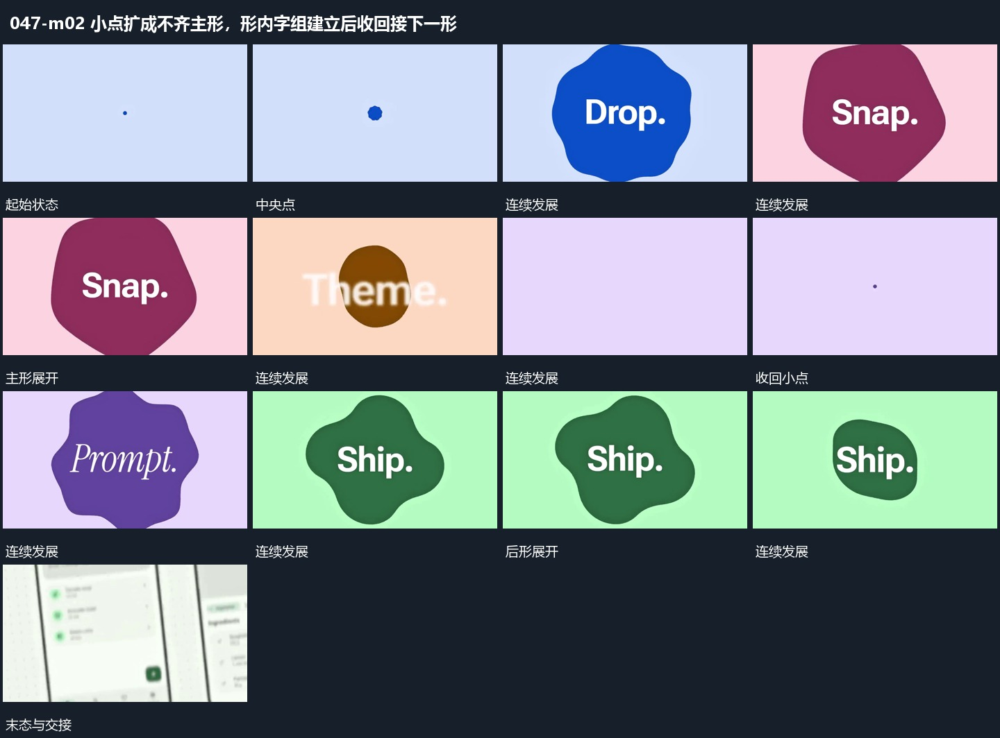

# 小点扩成不齐主形，形内字组建立后收回接下一形

## 运动指令

从中央小点扩成不齐边缘主形，在形内建立短字。完成后把形和字收回小点，再从同一位置展开下一主形；末尾沿扩张方向接入下一画面。

## 视频切片

[播放本机制的原片切片](m02.mp4)

覆盖分镜中“中央点”至“进入下一画面”的连续过程，并保留邻近的前后衔接画面；原片中交叠发生的动作一并保留。

## 分镜过程

## 组合与调整

不必沿用原轮廓，保留展开与收回的同一中心。
