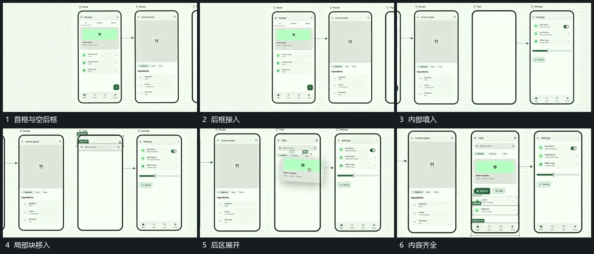

# 多个竖框横向接续，局部块填入并连向下一框

## 运动指令

建立多个横向排列竖框，先完成当前框内部，再用短连接线指向下一框。后框逐项填入局部块，已有框保持，最后多个框构成连续状态组。

## 视频切片

[播放本机制的原片切片](m03.mp4)

覆盖分镜中“首框与空后框”至“内容齐全”的连续过程，并保留邻近的前后衔接画面；原片中交叠发生的动作一并保留。

## 分镜过程

## 组合与调整

框数可减，连接要对应实际接续，不同时填满所有框。
