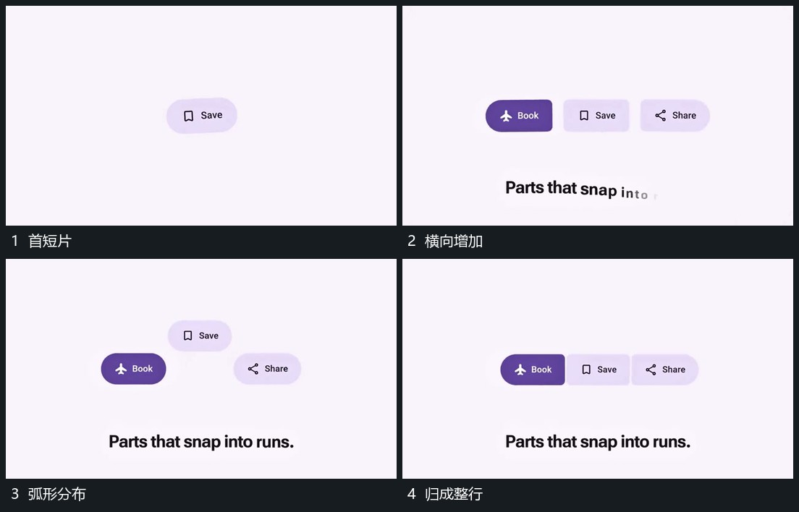

# 短片从散开排列成弧，再吸附回横向整行

## 运动指令

先建立一个短片，再接入两侧短片。让它们暂时形成弧形分布，随后向共同横线靠拢并吸附落位，片间间距收紧，整体稳定。

## 视频切片

[播放本机制的原片切片](m06.mp4)

覆盖分镜中“首短片”至“归成整行”的连续过程，并保留邻近的前后衔接画面；原片中交叠发生的动作一并保留。

## 分镜过程

## 组合与调整

数量可以换，保留从松散到整齐的组内关系。
