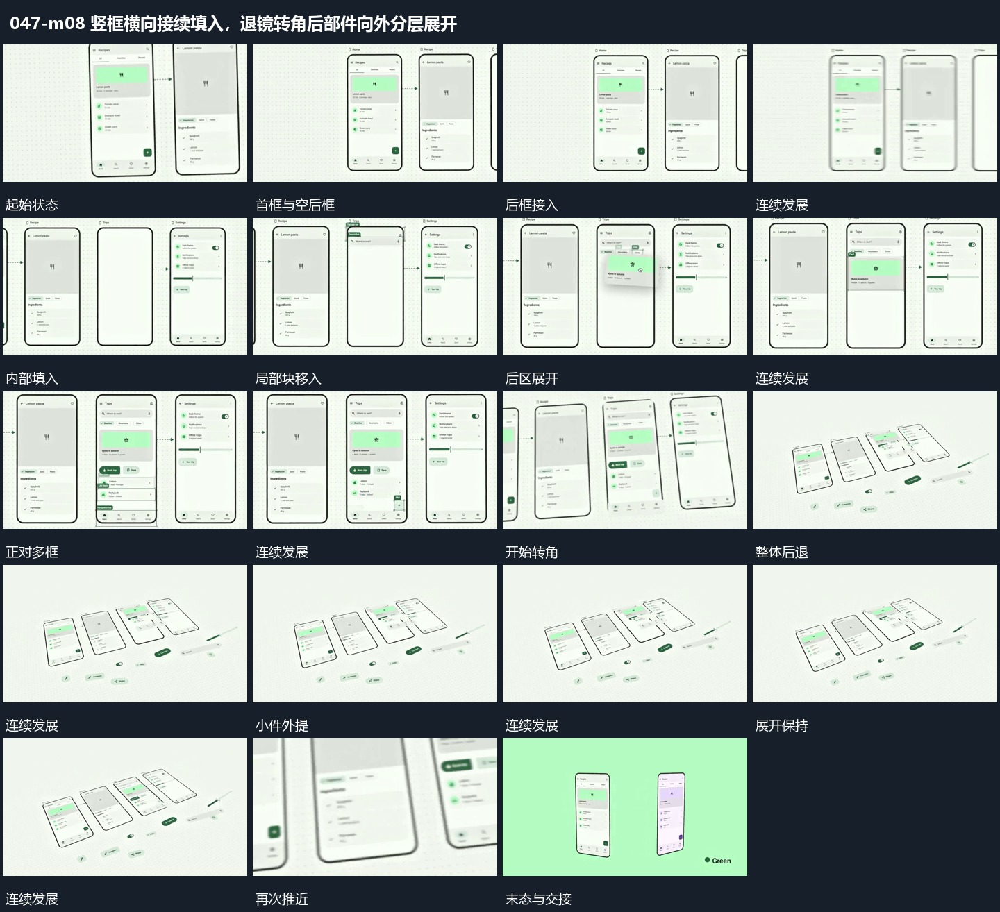

# 竖框横向接续填入，退镜转角后部件向外分层展开

## 运动指令

多个竖框沿横向接续，内部块逐项落位并传向下一框；随后退镜改变观看角度，内部小件外提为分层展开。

1. **多个竖框横向接续，局部块填入并连向下一框**

建立多个横向排列竖框，先完成当前框内部，再用短连接线指向下一框。后框逐项填入局部块，已有框保持，最后多个框构成连续状态组。

2. **退镜转角，框内小件外提到前层形成分层展开**

从正对多框的布局后退并改变观察角度，让框面显出倾斜关系。将框内小件提到前层，保留对应来源，形成面在后、小件在前的展开组；末尾再推近回到主要框。

整段结束：框面后退，小件悬在前层 保留必要落稳与交接，中间已建立的参照沿用到下一步骤。

## 视频切片

[播放本机制的原片切片](m08.mp4)

保留起始准备、连续发展和完成或明确交接；首尾按本段运动范围裁切，不拼接、不变速。相连的小动作合为同一完整段落。

## 分镜过程

## 组合与调整

多个竖框沿横向接续，内部块逐项落位并传向下一框；随后退镜改变观看角度，内部小件外提为分层展开。 复用时可调整元素数量、幅度和相对节奏，保留上述进入、交叠与完成关系；不直接沿用原片题材或时长。

框数可减，连接要对应实际接续，不同时填满所有框。

外提不需要复制原主体。镜头与小件必须共同建立空间关系，不凭空散开所有部件。
