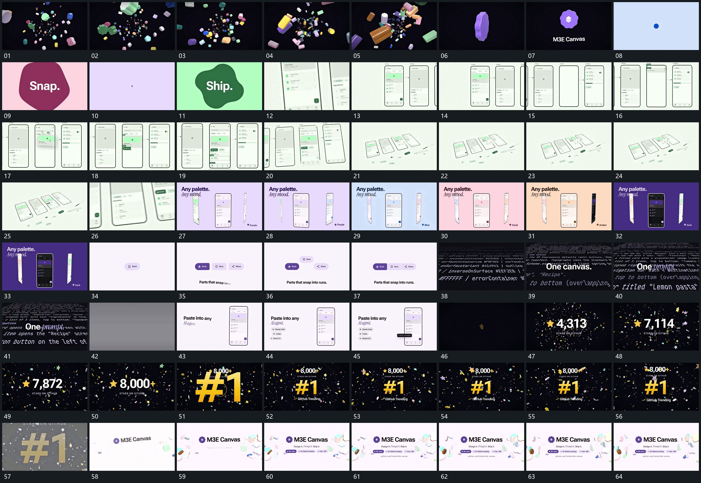

# 047｜原片运动总览

[观看完整原片](video.mp4)

## 运动总览

开头 镜头穿过远近散块，保留一个近块转正接管 在有远近的散块空间前进，再保留一个近块，让它转正接管中央。小点扩成不齐主形，形内字组建立后收回接下一形 用小点扩成不齐主形，字组在形内建立，主形随后收回，再展开下一形。多个竖框横向接续，局部块填入并连向下一框 将多竖框水平接续，局部块按关联填入并连接到下一框。

中段 退镜转角，框内小件外提到前层形成分层展开 退镜并转观察角度，把框内小件外提到前层，完整组转成分层展开状态。竖片列轮转，中央片转正保持，边缘片侧立 让竖片列轮转，中央片转正保持，边缘片侧立。短片从散开排列成弧，再吸附回横向整行 将散开的短片弧形排列，再回到横向整行。后层密集字面斜铺，镜头沿面前掠，前景短字保持。

后段主竖框与旁字建立，短标签逐项补入。数值增长后缩小上移，大字由大缩回中央 在散片持续经过时让中央数值增长，完成后数值缩小上移，新的大字由大缩回中央。最后换入新布局，重用 镜头穿过远近散块，保留一个近块转正接管 的散块活动作为外围，主字、附属行、小条逐项补齐，结束保持。

## 完整运动段落

以下按原片中的出现顺序引用。建立、内部发展及完成反馈放在同一段中；同时发生的局部动作与运镜写在同一份指令里。不同段之间可以是连续接管，也可以是直接切换，不能仅凭条目相邻认定可直接拼接。重复出现的同类运动采用一次连续代表范围，切片不以逐段无缝覆盖整片为目标。

1. [镜头穿过远近散块，保留一个近块转正接管](mechanisms/m01.md)：镜头前进，选块保留，其余退去

2. [小点扩成不齐主形，形内字组建立后收回接下一形](mechanisms/m02.md)：展开后收回，再继续下一组

3. [竖框横向接续填入，退镜转角后部件向外分层展开](mechanisms/m08.md)：多个竖框沿横向接续，内部块逐项落位并传向下一框；随后退镜改变观看角度，内部小件外提为分层展开。

4. [竖片列轮转，中央片转正保持，边缘片侧立](mechanisms/m05.md)：整列轮转，选片到中央停留

5. [短片从散开排列成弧，再吸附回横向整行](mechanisms/m06.md)：先补片，再弧排，最后归整

6. [数值增长后缩小上移，大字由大缩回中央](mechanisms/m07.md)：旧值先落稳让位，新字再接上

切片保留起始准备、必要内部停顿和完成或明确交接；首尾省略无新发展的等待，持续运动不要求人为停住。以上基于真实源帧序列和重点边界核对，不等同于全片连续声画审片。

## 完整64宫格

