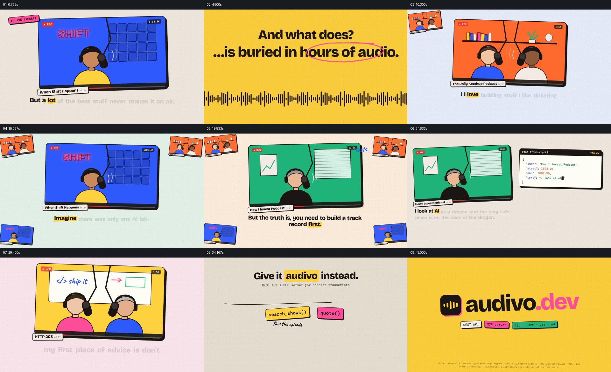

# 让多个播客节目逐一成为主画面，再落到可引用的文字

- 作品：案例 086。
- 原片范围：00:00.000–00:52.600（源时间，起点包含、终点不包含）；[完整原片](../video.mp4)｜[本卡片段](../video.mp4)。范围覆盖整片；相较旧卡延长至完整结尾，直接引用原片。
- 观察方式与未确认范围：查看完整原片 64 帧总览和本卡分镜；未独立连续原速观看及听审，抽帧间动作、精确速度、声音与同步均未确认；以下价值判断是作品分析，迁移尚未实测。

## 原画面具体怎样设计

浅米色底上，一张蓝底播客窗口显示戴耳机的简化人物、录制标记、节目名称和右上角时间；窗口下方的句子有黄色重点。随后黄色全屏与一条波形承接“内容被埋在数小时音频里”的画内文字，提出查找困难。

之后橙色双人节目窗口成为主体，蓝色节目稍后接管；前一个节目会以小窗口留在角落，新的主窗口在中间放大，配套的文字在窗口下方出现。绿色背景的另一节目进入时，角落仍有其他节目的小图作参照；画面再把多个节目窗口排成一组，并用中央提示强调智能体不能直接按播放键。

约 00:24，绿色节目留在左侧，右侧出现类似代码结果的框，含节目名、开始和结束时间、文字字段；窗口下方同时出现对应句子。之后又换成黄色双人节目及其文字，画面转入“Give it audivo instead.”，把查找节目、引用、确认、读取文字等标签排成一条操作序列。尾部再次出现节目窗口和字幕，最后由“Podcast transcripts. Ready to build on.”及品牌标志收束。

## 为什么这样设计，好在哪里

每个节目都用不同底色、人物数量、标题和窗口位置保持身份，而下方文字及右侧的时间字段让注意力从“正在播放的节目”转到“可定位的一句话”。前一个节目缩到角落时仍留作多来源的参照；当它们汇成一组，再出现不能直接播放的提示，问题才有了可见的材料基础。

代码式框与节目窗口并置，使输入来源和输出片段在同一画面中对应；最后把若干功能标签排成一条路径，说明用途。这里只能确认片中如何演示，不能由窗口和时间字段证明检索准确、原音真实或服务已经运行。

## 可直接使用的创意指令

当需要说明多份长内容如何变成可定位、可引用的材料，选取来源明确的节目、访谈或文档，用各自可辨的窗口、名称与内容片段建立身份；让一个来源获得主位置时，将其他来源适度退到角落，保留“有多份材料”的参照。

先展示查找困难，再把一条实际内容和对应的文字、时间或位置放在同一视野；只有这些字段可以真实对应时，才进一步展示查询、引用或交给下游的步骤。最后用可读的结果或下一步收束。来源数量、插画风格、功能标签和载体可改；关键是“来源对象—被定位的片段—可用结果”之间有可追踪关系。材料或接口只是示例时应清楚标注，涉及语音节奏的表达需另外听审。
