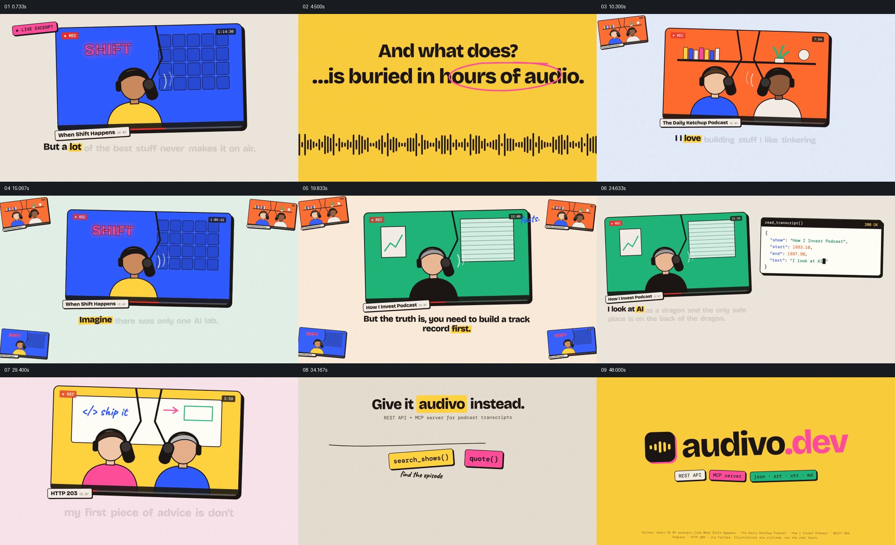

# 让多个播客节目逐一成为主画面，再落到可引用的文字

- 作品：案例 086。
- 原片范围：00:00.000–00:52.600（源时间，起点包含、终点不包含）；[完整原片](../video.mp4)｜[本卡片段](../video.mp4)。范围覆盖整片；相较旧卡延长至完整结尾，直接引用原片。
- 观察方式与未确认范围：查看完整原片 64 帧总览和本卡分镜；未独立连续原速观看及听审，抽帧间动作、精确速度、声音与同步均未确认；以下价值判断是作品分析，迁移尚未实测。

## 原画面具体怎样设计

浅米色底上，一张蓝底播客窗口显示戴耳机的简化人物、录制标记、节目名称和右上角时间；窗口下方的句子有黄色重点。随后黄色全屏与一条波形承接“内容被埋在数小时音频里”的画内文字，提出查找困难。

之后橙色双人节目窗口成为主体，蓝色节目稍后接管；前一个节目会以小窗口留在角落，新的主窗口在中间放大，配套的文字在窗口下方出现。绿色背景的另一节目进入时，角落仍有其他节目的小图作参照；画面再把多个节目窗口排成一组，并用中央提示强调智能体不能直接按播放键。

约 00:24，绿色节目留在左侧，右侧出现类似代码结果的框，含节目名、开始和结束时间、文字字段；窗口下方同时出现对应句子。之后又换成黄色双人节目及其文字，画面转入“Give it audivo instead.”，把查找节目、引用、确认、读取文字等标签排成一条操作序列。尾部再次出现节目窗口和字幕，最后由“Podcast transcripts. Ready to build on.”及品牌标志收束。

## 为什么这样设计，好在哪里

每个节目都用不同底色、人物数量、标题和窗口位置保持身份，而下方文字及右侧的时间字段让注意力从“正在播放的节目”转到“可定位的一句话”。前一个节目缩到角落时仍留作多来源的参照；当它们汇成一组，再出现不能直接播放的提示，问题才有了可见的材料基础。

代码式框与节目窗口并置，使输入来源和输出片段在同一画面中对应；最后把若干功能标签排成一条路径，说明用途。这里只能确认片中如何演示，不能由窗口和时间字段证明检索准确、原音真实或服务已经运行。

## 完整照排指令

以[完整原片](../video.mp4)的 0–52.6 秒为准。画幅 1280×720，源帧率 30/1。以下拍点为抽帧定位，位置按画幅百分比取近似值。

### 源时刻照排

- 0–约 8 秒，浅米底中上摆蓝色【节目窗口甲】，保留录制标、节目名和角落时间；下方黑色【节目引句】将关键词衬黄。随即整幅切明黄，居中大号【检索难点】与下方深色【音频波形】取代窗。
- 约 8–24 秒，橙色【节目窗口乙】居中，蓝窗稍后接管并将橙窗缩至上角。绿色【节目窗口丙】进入时其他节目也在角落作小窗。大窗底部换对应【节目引句】，角窗保留各自色和轮廓。末端拼成多窗网格，暗化并居中压白卡【播放限制句】。
- 约 24–35 秒，绿色窗留左，右并列白底黑边【转写结果】，用近似等宽体分行排【节目名】【起止时间】【转写原句】。左窗下方仍放同一原句；之后黄色【节目窗口丁】及配套引句重新独占画面。
- 约 35–52.600 秒，浅底黑粗体【操作引子】中高亮产品名，下排不同颜色的【操作标签】表示查找、引用、确认、读取。随后黄色窗接回，给对应引句；末段收为黑粗体【收尾主张】和粉底副行，再切全黄【品牌标识】至片尾。

### 用料与取用

【节目窗口甲】【节目窗口乙】【节目窗口丙】【节目窗口丁】各交节目视觉、无重复的足长片段及经核对的【节目引句】。轮换时大窗和缩小后的同名节目共用同源片段及播放进度，乙自约 8 秒建立、至 24 秒组图，甲自开场建立并在换窗段再现，丙约 18 秒进入并持续至 24 秒后左右证据拍，丁约 29 秒建立并在末段重入。需连续的片段换窗尺寸时不重播、不定格、不用照片运镜；角窗动作待原速确认，素材先留余量，纯身份缩略图可用静帧。【音频波形】交相应音段数据；【转写结果】中的【节目名】【起止时间】【转写原句】须对应同一左窗节目，给原始节目 URL、期次、可核对时间及全文片段。供【检索难点】【播放限制句】【操作引子】【操作标签】【收尾主张】【品牌标识】，真实产品流程主张附版本及出处。只有节目和对齐转写时单用约 24–29 秒，只有输入操作序列时用约 35–42 秒。

### 验证状态

已对照原片等距抽帧与卡稿，核对大窗换位、角窗身份、左右转写对应和标签排布；角窗连续播放、原句精确同步、帧级切点及换料试摆待核。
