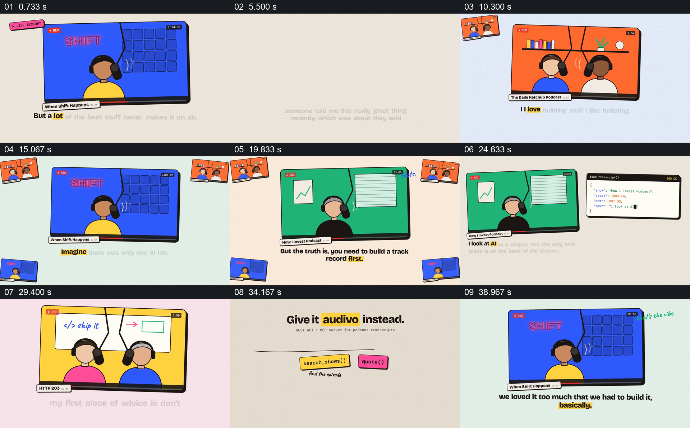

# 从多个播客片段转到可检索的文字材料

- 作品：案例 086《播客材料与转录服务》（本次概括）。
- 原片范围：00:00.000–00:43.000，含起点、不含终点；[完整原片](../video.mp4)｜[本卡片段](c01.mp4)。
- 观察方式：依据约每秒一次的真实源帧观察，未连续原速观看或听审；声音、语气与完整播放节奏未确认。

## 原画面具体怎样设计

多个彩色模拟播客窗口依次显示说话者，底部文字逐词高亮；黄色页面说明内容埋在长音频中，随后节目窗口以小缩略图在边缘累积。多个节目组成网格，提示智能体无法按播放；一侧模拟终端与节目画面并列，接着不同节目再出现，搜索节目、集数、内容和读取转录等接口标签逐项排开，最后回到“可供构建的播客转录”文字。

## 为什么这样设计，好在哪里

同一种节目窗口反复出现，边缘小图逐步累积素材规模；节目画面、可读文字与终端并列，让观众看到服务试图连接声音内容和程序使用。节目内容、转录准确性和接口能力均为展示，未核验。

以上为依据画面的分析，非作者自述；预期观看效果未经观众测试。

## 可直接使用的创意指令

介绍音频资料的检索或转录服务时，先展示真实有权使用的节目和需查找的内容，让节目身份和可读文字对应；再展示从搜索到定位和读取的实际操作与结果，保留来源和时间位置。接口、文字准确性及版权范围须依据实际服务核对。
