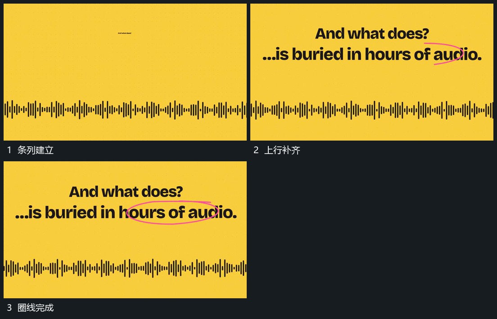

# 全幅短条高低起伏上行建立后圈线划过

## 运动指令

让横向短条列在固定基线附近改变高度，不整体横移。上方两行短字随后建立，完成后沿其中一段外围延出圈线并闭合。短条仍持续起伏，圈定后上行保持，不随短条每次变化闪动。

## 视频切片

[播放本机制的原片切片](m02.mp4)

覆盖分镜中“条列建立”至“圈线完成”的连续过程，并保留邻近的前后衔接画面；原片中交叠发生的动作一并保留。

## 分镜过程

## 组合与调整

可用其他密集列形；圈线起点对准已有文字范围，保持上下层职责清楚。
