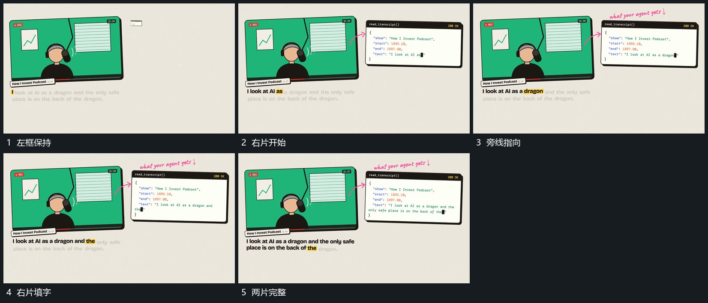

# 左框保持右片接入并连续填入字行

## 运动指令

保留左框，在旁侧空处建立右片的边界与顶部短条。字行从上向下分次填入，已填部分保持；旁侧短箭头从左框指向右片，并在箭头末端补小行。两片完成后维持原相对位置。

## 视频切片

[播放本机制的原片切片](m05.mp4)

覆盖分镜中“左框保持”至“两片完整”的连续过程，并保留邻近的前后衔接画面；原片中交叠发生的动作一并保留。

## 分镜过程

## 组合与调整

可换成图块投影；箭头对齐两片之间的空区，避免盖住右片正在填入的内容。
