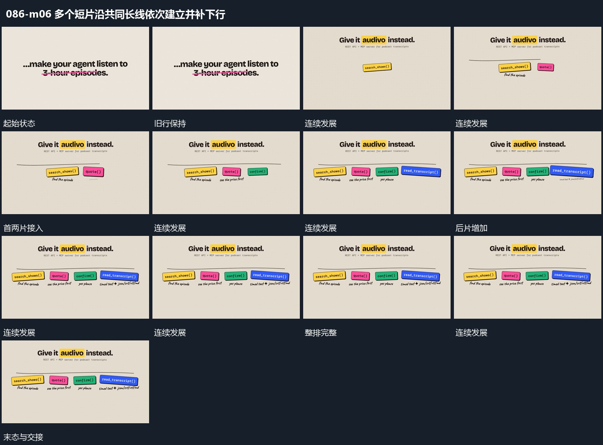

# 多个短片沿共同长线依次建立并补下行

## 运动指令

先建立横向长线作为共同参照，多个短片沿线依次出现，带轻微不同倾角。每片完成后保持，并在其下方补短行，后片继续占据相邻空处。整排齐全后只保留局部轻微变化。

## 视频切片

[播放本机制的原片切片](m06.mp4)

覆盖分镜中“旧行保持”至“共同保持”的连续过程，并保留邻近的前后衔接画面；原片中交叠发生的动作一并保留。

## 分镜过程

## 组合与调整

可减少片数，不需要指定固定数量；片与对应下行应在同一区域建立。
