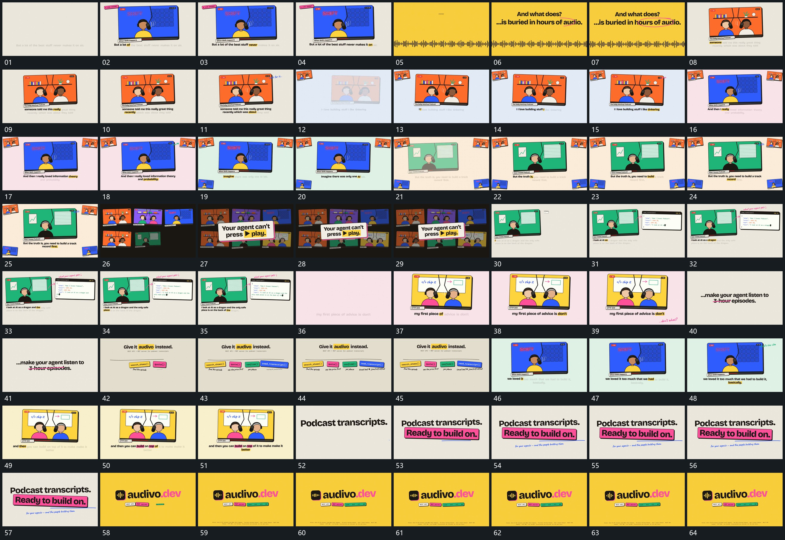

# 086｜原片运动总览

[观看完整原片](video.mp4)

## 运动总览

全片反复复用主框建立后下方短行逐项增强并延长，建立主框并让下方短行逐项增强。中间穿插全幅短条高低起伏上行建立后圈线划过的横向短条起伏和圈线划过。多个主框接替时，旧片缩到边缘保持中央主框接替把先前片面缩到边缘继续保留；随后阵列后层退弱中央斜框放大接管展开多片阵列、减弱后层并用中央框接管。

下一段左框保持右片接入并连续填入字行在左框旁建立右片并连续填入字行，底部短行继续复用主框建立后下方短行逐项增强并延长。后段多个短片沿共同长线依次建立并补下行让多个短片沿同一长线依次建立，结尾上行先建立下方框带接入再扫下线由上行、下方框带、下线和附属小行形成完整收尾组。

## 完整运动段落

以下按原片中的出现顺序引用。建立、内部发展及完成反馈放在同一段中；同时发生的局部动作与运镜写在同一份指令里。不同段之间可以是连续接管，也可以是直接切换，不能仅凭条目相邻认定可直接拼接。重复出现的同类运动采用一次连续代表范围，切片不以逐段无缝覆盖整片为目标。

1. [主框建立后下方短行逐项增强并延长](mechanisms/m01.md)：框先建立下行后推进

2. [全幅短条高低起伏上行建立后圈线划过](mechanisms/m02.md)：条列持续上层建立划圈

3. [旧片缩到边缘保持中央主框接替](mechanisms/m03.md)：旧片缩移新片接入

4. [阵列后层退弱中央斜框放大接管](mechanisms/m04.md)：后层退让前框展开

5. [左框保持右片接入并连续填入字行](mechanisms/m05.md)：右片建立后逐字填入

6. [多个短片沿共同长线依次建立并补下行](mechanisms/m06.md)：沿线累积下行随后补入

7. [上行先建立下方框带接入再扫下线](mechanisms/m07.md)：上行下行下线依次完成

切片保留起始准备、必要内部停顿和完成或明确交接；首尾省略无新发展的等待，持续运动不要求人为停住。以上基于真实源帧序列和重点边界核对，不等同于全片连续声画审片。

## 完整64宫格

