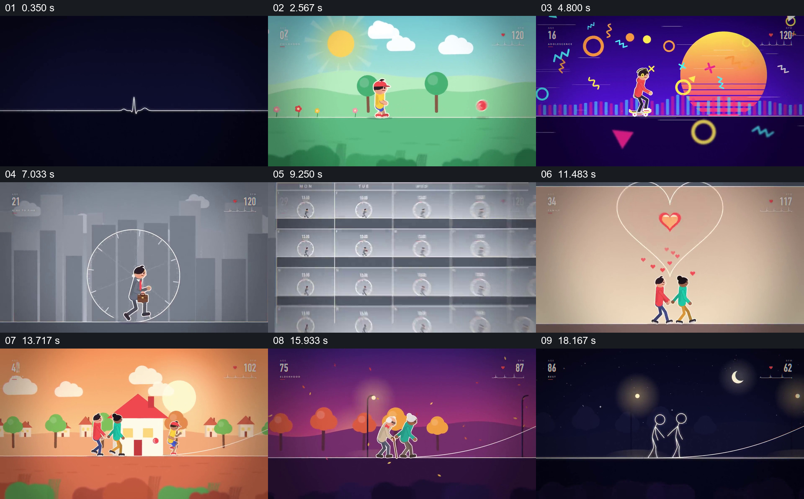

# 让一条线穿过不同人生场景与关系变化

- 作品：案例 074《沿一条生命线走过人生阶段》（本次概括）。
- 原片范围：00:00.000–00:20.053，含起点、不含终点；[完整原片](../video.mp4)｜[本卡片段](../video.mp4)。
- 观察方式：依据约每秒一次的真实源帧观察，未连续原速观看或听审；声音、语气与完整播放节奏未确认。

## 原画面具体怎样设计

黑底上的细线先形成小人，随即变成晴朗草地上的儿童；画面转为鲜艳的青春活动场景，再进入灰色城市和时钟中的工作人物。此后两个人相遇，画面变为住宅与同行的家庭，最后出现两位老人，在夜色中变回线条人物，画面退至细线。年龄和心形等符号伴随阶段变化。

## 为什么这样设计，好在哪里

同一条横向路径为变化的场景提供连续参照，场景气氛和人物关系则让人生阶段可区分；两人共同走到晚年，使中段相遇不只是孤立画面。片中数字和场景为概括性表达。

以上为依据画面的分析，非作者自述；预期观看效果未经观众测试。

## 可直接使用的创意指令

需要压缩跨年历程时，先选择可追踪的人物或关系，并设置贯穿全段的路径；每次改变环境时用具体行动和同伴变化标记阶段，保留前一阶段留下的关系，最后给出能够回应起点的状态。人生顺序与事实应依据真实材料，避免把单一路径当作所有人的经历。
