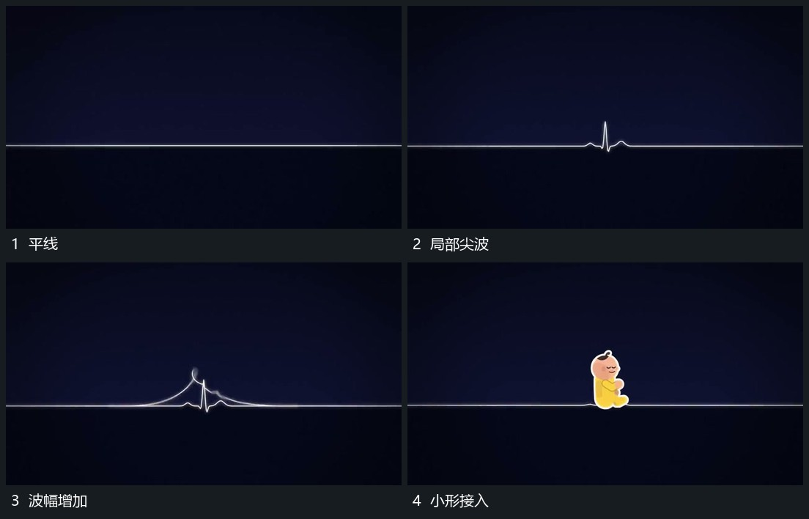

# 平线局部起伏后建立线上小形

## 运动指令

保留横向线的两端，只让中部局部向上抬起并回落，形成先小后大的短波。波形经过后在同一线附近接入小主形；线继续穿过画面，作为其后动作的共同底部参照。

## 视频切片

[播放本机制的原片切片](m01.mp4)

覆盖分镜中“平线”至“小形接入”的连续过程，并保留邻近的前后衔接画面；原片中交叠发生的动作一并保留。

## 分镜过程

## 组合与调整

可重复波形而不每次增加对象；保留连续线便于接后续横移。
