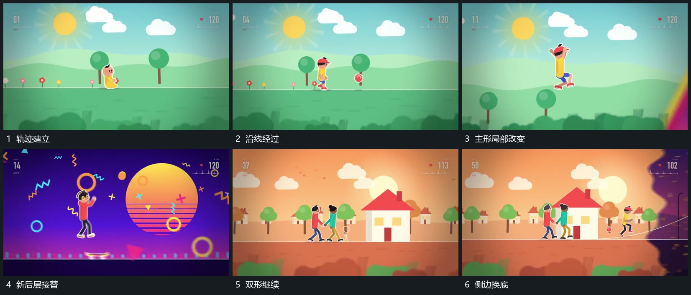

# 主形沿底线经过后层分层视差接替

## 运动指令

让主形沿底线持续经过，取景随其前进，后层不同远近的片层以不同幅度反向经过。需要改变后层时从一侧让新区域接入，底线和主形的前进不中断。旁侧小形可在途中加入，加入后与已有组形共享同一轨迹。

## 视频切片

[播放本机制的原片切片](m03.mp4)

覆盖分镜中“轨迹建立”至“侧边换底”的连续过程，并保留邻近的前后衔接画面；原片中交叠发生的动作一并保留。

## 分镜过程

## 组合与调整

轨迹可逐步上扬；后层位移幅度有层次，不能全部与主形锁在一起。
