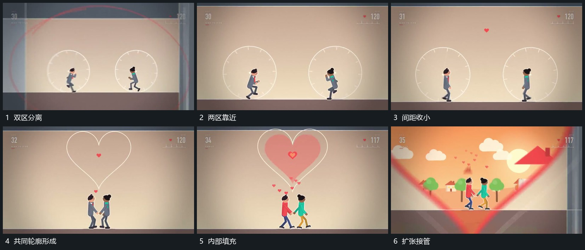

# 两个圆区靠近接成新轮廓再扩张

## 运动指令

让两个独立圆区向中间靠近，内部组形同时沿底线收近。两圆相接后保留上部双弧，下部收成共同尖端，使分离边界成为一个完整外轮廓。内部填充从中心展开，外边界继续扩大并打开下一空间。

## 视频切片

[播放本机制的原片切片](m06.mp4)

覆盖分镜中“双区分离”至“扩张接管”的连续过程，并保留邻近的前后衔接画面；原片中交叠发生的动作一并保留。

## 分镜过程

## 组合与调整

可换成其他双边界合拢；合成前保留两区身份，合成后统一外边界再向外扩张。
