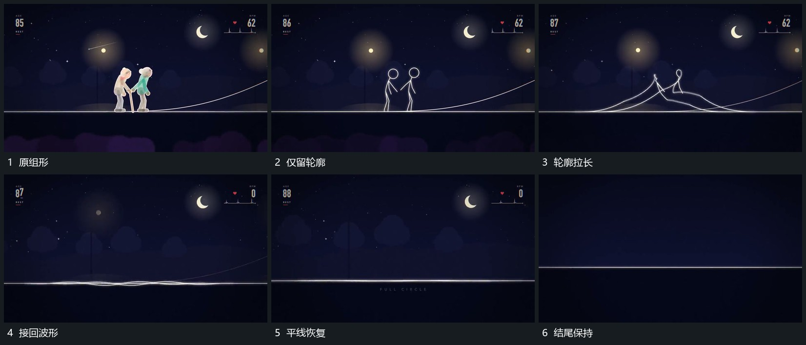

# 组形减为细轮廓再拉伸回平线

## 运动指令

先减弱组形内部，只留下连续细轮廓。轮廓顶部下降、横向跨度增加，与底线逐渐相接，形成较低的长波。多余起伏继续变小，最终并入平直线；下方短字最后保持，完成首尾接续。

## 视频切片

[播放本机制的原片切片](m07.mp4)

覆盖分镜中“原组形”至“结尾保持”的连续过程，并保留邻近的前后衔接画面；原片中交叠发生的动作一并保留。

## 分镜过程

## 组合与调整

从任意轮廓返回线条时，都先保留连通关系再减少高度；不要直接用淡出替代变形过程。
