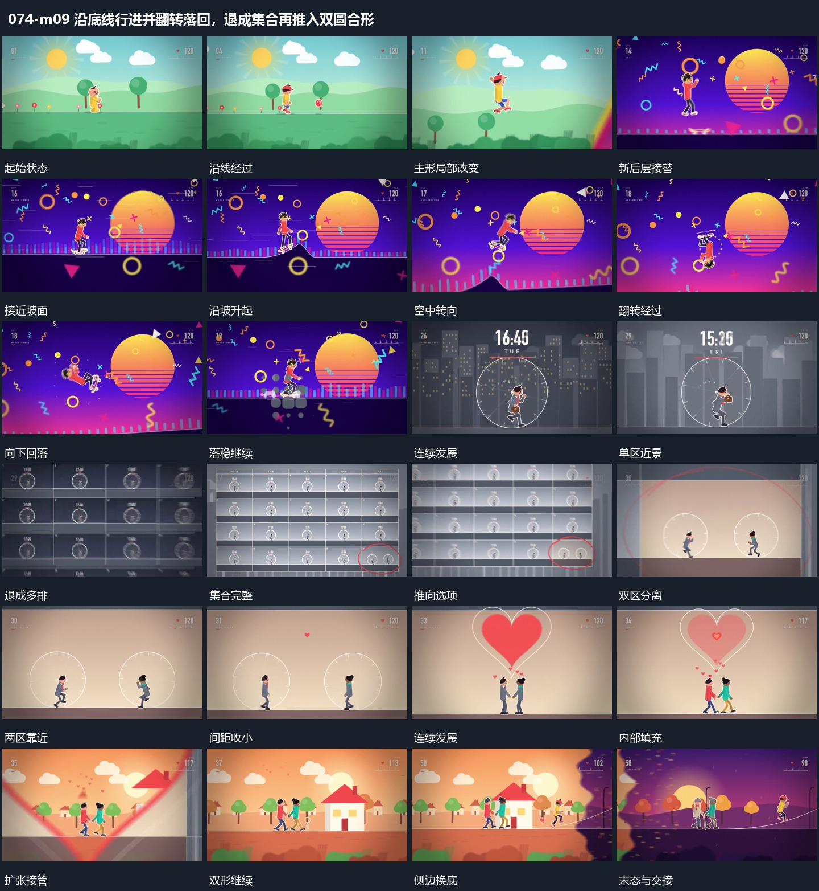

# 沿底线行进并翻转落回，退成集合再推入双圆合形

## 运动指令

起始：主形位于水平或上扬轨迹。

1. 主形沿连续底线经过不同层次，局部坡道上升引出翻转并落回。

2. 单区退成多排集合后推入选区，两个圆区靠拢、合成新轮廓并扩张接场。

上述镜头变化与局部动作按同一条连续过程推进；写明同时发生的步骤在原场面中交叠，不先完成整段运镜再重演局部。

## 视频切片

[播放本机制的原片切片](m09.mp4)

保留起始准备、连续发展和完成或明确交接；首尾按本段运动范围裁切，不拼接、不变速。相连的小动作合为同一完整段落。

## 分镜过程

## 组合与调整

保留以下动作关系：主形沿连续底线经过不同层次，局部坡道上升引出翻转并落回；单区退成多排集合后推入选区，两个圆区靠拢、合成新轮廓并扩张接场。

可调整位移距离、层级间距、重复数量与相对快慢；已有锚点和未退出的层继续承接。连接下一段时以切片末态为起点，另行设计不连续的状态转换。
