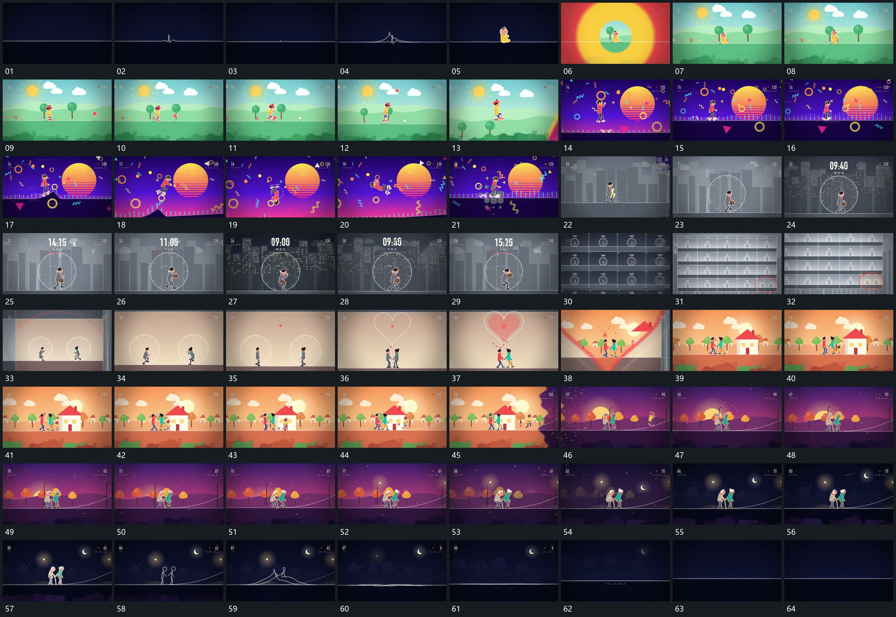

# 074｜原片运动总览

[观看完整原片](video.mp4)

## 运动总览

全片以平线局部起伏后建立线上小形从平直细线发展出局部波和小形，围主形的圆边界扩张覆盖并换底围绕小形扩张覆盖，打开沿底线连续经过的空间。主形沿底线经过后层分层视差接替保持主形与轨迹连续，后层按不同幅度经过；经过坡面时接入沿坡升起翻转后落回底线继续的升起、翻转和落稳。

中段以圆边界包住主形，外围短条在原位接替；再用单区退为多排集合再推向局部选项退为多排集合并推向一个选项。选项中的双圆通过两个圆区靠近接成新轮廓再扩张靠近、相接、形成新轮廓，其扩张复用围主形的圆边界扩张覆盖并换底接管后层。两组形继续复用主形沿底线经过后层分层视差接替，轨迹上扬而旁形分次接入。末段用组形减为细轮廓再拉伸回平线把组形减为轮廓，再拉伸回细线与短波，最终回到平直起点。

## 完整运动段落

以下按原片中的出现顺序引用。建立、内部发展及完成反馈放在同一段中；同时发生的局部动作与运镜写在同一份指令里。不同段之间可以是连续接管，也可以是直接切换，不能仅凭条目相邻认定可直接拼接。重复出现的同类运动采用一次连续代表范围，切片不以逐段无缝覆盖整片为目标。

1. [平线上起伏长出小形，外围圆边扩张揭出新底](mechanisms/m08.md)：细线上局部起伏逐渐长出小形，圆形围边接入并向外扩张覆盖，揭出后层的新场面。

2. [沿底线行进并翻转落回，退成集合再推入双圆合形](mechanisms/m09.md)：主形沿连续底线经过不同层次，局部坡道上升引出翻转并落回；单区退成多排集合后推入选区，两个圆区靠拢、合成新轮廓并扩张接场。

3. [组形减为细轮廓再拉伸回平线](mechanisms/m07.md)：轮廓简化后贴线拉伸

切片保留起始准备、必要内部停顿和完成或明确交接；首尾省略无新发展的等待，持续运动不要求人为停住。以上基于真实源帧序列和重点边界核对，不等同于全片连续声画审片。

## 完整64宫格

