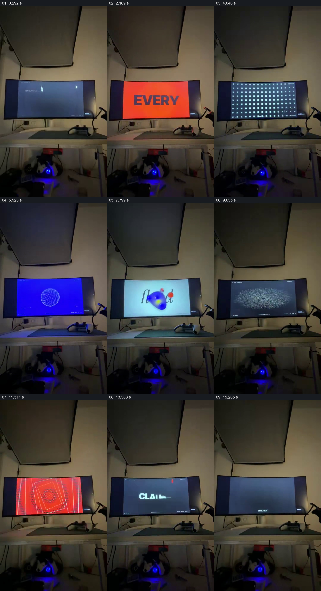

# 固定桌面作为窗口，观看屏内图形连续变换

- 作品：案例 023《桌面显示器里的连续视觉短片》（索引名称）。
- 原片范围：00:00.000–00:16.834，含起点、不含终点；[完整原片](../video.mp4)｜[本卡片段](../video.mp4)。
- 观察方式：依据整片 64 宫格和约每秒一次的真实源帧观察，未连续原速观看或听审；声音、语气与完整播放节奏未确认。

## 原画面具体怎样设计

竖幅固定取景中，显示器放在桌上，周围可见灯具、桌下设备和墙面。屏幕先出现文字，再显示彩色方格、蓝色圆形与抽象图像、文字和一组横向条纹；末尾屏内出现 CLAUDE 标识，桌面实景的位置始终保持。

## 为什么这样设计，好在哪里

不切离桌面，让屏幕成为稳定的观察窗口；屏内不同颜色和形状的替换因此可以在同一尺度下比较，真实环境也给数字画面提供展示场所。逐秒抽样不能完整判断变化节奏和屏幕细字。

以上为依据画面的分析，非作者自述；预期观看效果未经观众测试。

## 可直接使用的创意指令

当要展示多种视觉状态且希望保留实际展示环境时，用固定视点拍摄可辨的显示设备及少量环境参照，在同一屏幕位置依次呈现相关作品，最后给出实际身份或出处。确保屏幕内容清晰可读、素材授权明确；切换节奏应根据连续播放实际审看调整。
