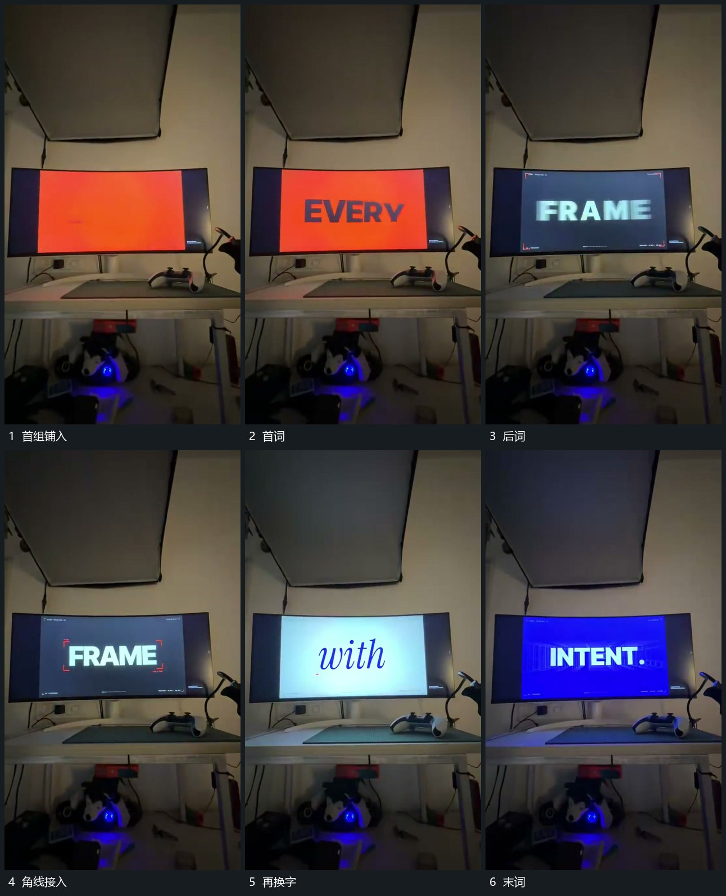

# 中央词组快速接替，局部线形随后强调

## 运动指令

在同一中央位置快速接替短词，不同段使用直接换底或模糊过渡。每个词停清后再补短线或角线，附属形不抢在词组前出现。

## 视频切片

[播放本机制的原片切片](m01.mp4)

覆盖分镜中“首组铺入”至“末词”的连续过程，并保留邻近的前后衔接画面；原片中交叠发生的动作一并保留。

## 分镜过程

## 组合与调整

只借运动序列，实际字形与内容重做，预览图保留原片的拍摄边界。
