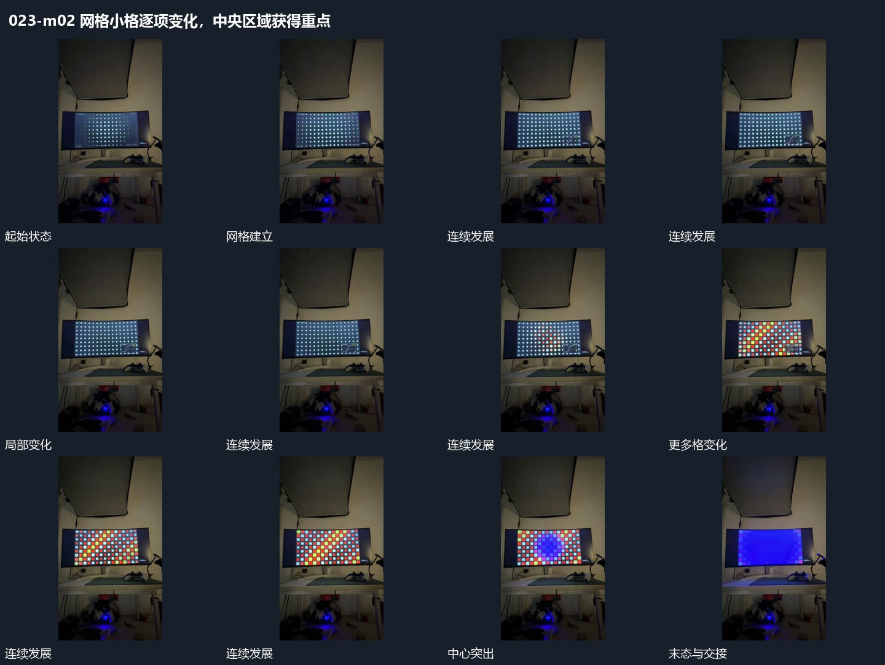

# 网格小格逐项变化，中央区域获得重点

## 运动指令

保持规则网格位置，小格按空间次序更换内部状态，中央区域渐显，外围继续可见。整组完成后退出，给下一圆形线组留空。

## 视频切片

[播放本机制的原片切片](m02.mp4)

保留起始准备、连续发展和完成或明确交接；首尾按本段运动范围裁切，不拼接、不变速。尾部只保留理解结果所需的展示。

## 分镜过程

## 组合与调整

状态可用大小或显隐改变，不能把所有格同帧重置代替过程。
