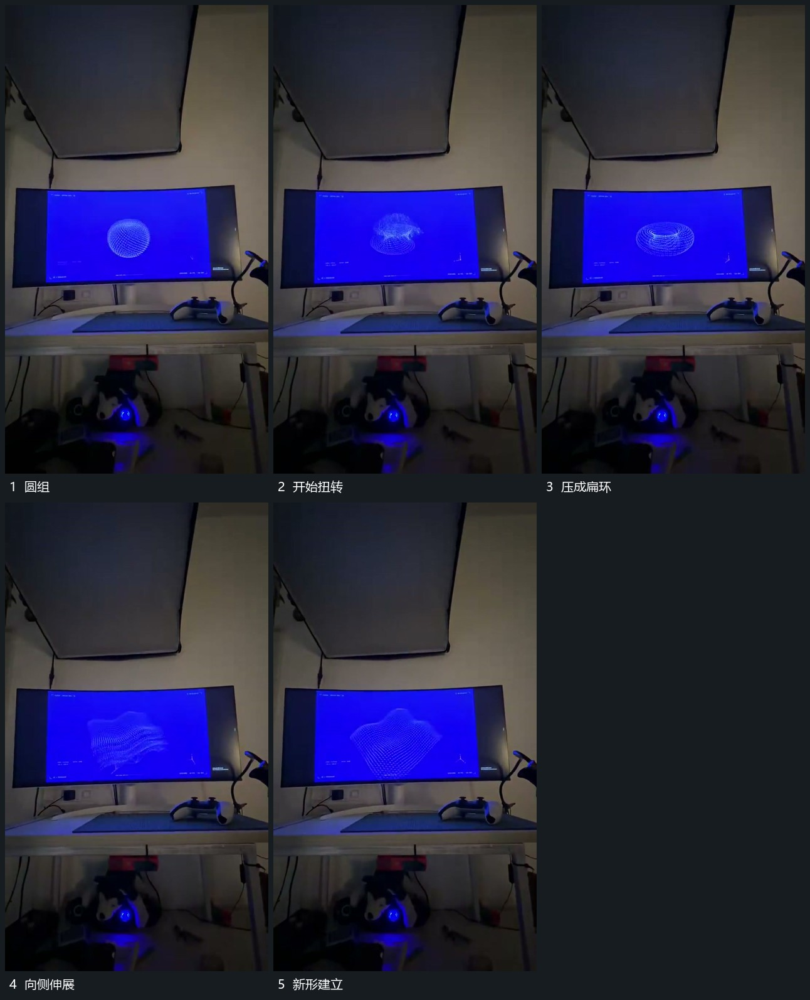

# 圆形线组压扁拉伸并扭转，中心位置保持

## 运动指令

围绕同一中心连续压扁、拉伸并扭转线组，线条内部分布跟着形态变化。变化在多种姿态间接续，之后整组退去，保留中央观看位置。

## 视频切片

[播放本机制的原片切片](m03.mp4)

覆盖分镜中“圆组”至“新形建立”的连续过程，并保留邻近的前后衔接画面；原片中交叠发生的动作一并保留。

## 分镜过程

## 组合与调整

不指定作者曲面或着色器，保留中心与形态接续关系。
