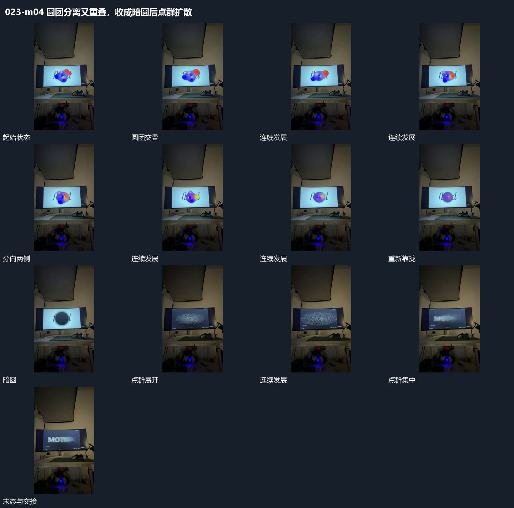

# 圆团分离又重叠，收成暗圆后点群扩散

## 运动指令

让圆团在中央交叠，向两侧短暂分离后又靠拢，末段收成较暗的圆。随后点群从原范围扩散再集中，借同一中心接续变化。

## 视频切片

[播放本机制的原片切片](m04.mp4)

保留起始准备、连续发展和完成或明确交接；首尾按本段运动范围裁切，不拼接、不变速。尾部只保留理解结果所需的展示。

## 分镜过程

## 组合与调整

不把圆团与点群说成同一真实几何层；需要明确换层接点。
