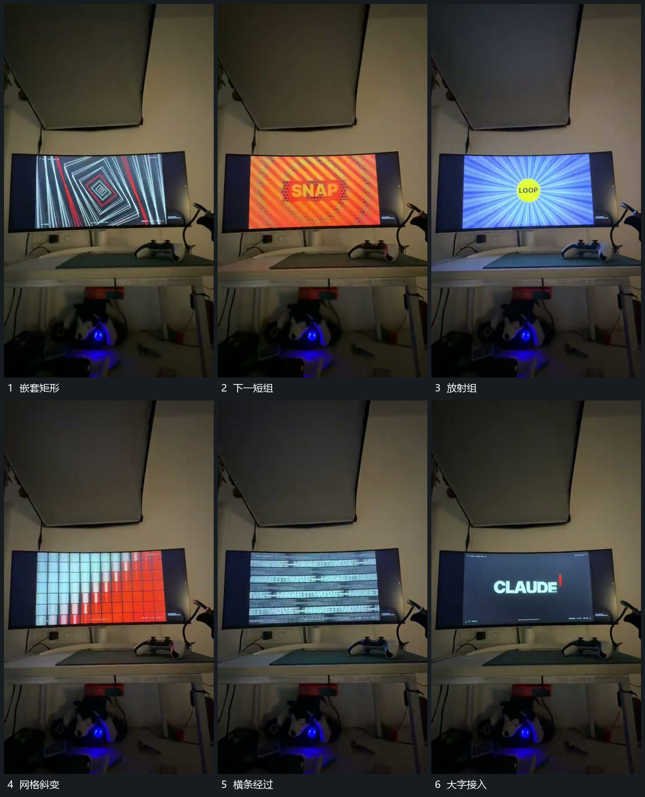

# 嵌套矩形向中心推进，网格斜向接替后横条经过

## 运动指令

让嵌套矩形沿中心连续推进，再接入数个短促全幅组；规则网格沿斜向改变局部状态，随后横向条组经过，最后退去露出大字。

## 视频切片

[播放本机制的原片切片](m05.mp4)

覆盖分镜中“嵌套矩形”至“大字接入”的连续过程，并保留邻近的前后衔接画面；原片中交叠发生的动作一并保留。

## 分镜过程

## 组合与调整

中间短组可减少，保留几何方向，避免仅堆不相关转场名称。
