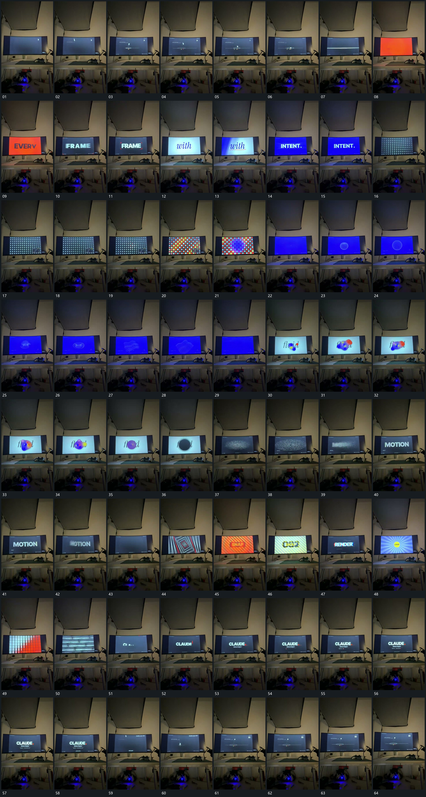

# 023｜原片运动总览

[观看完整原片](video.mp4)

## 运动总览

原片是拍摄画面内的动画，以下只提取其中的运动，不把外部拍摄环境写成机制。开头细小形落到横线附近，亮线短闪后进入 中央词组快速接替，局部线形随后强调 的中央词组轮换。

随后 网格小格逐项变化，中央区域获得重点 在规则网格中逐项改变小格状态，中心区域逐渐突出。换入圆形线组后，圆形线组压扁拉伸并扭转，中心位置保持 连续扭动、压扁和拉伸，同时保留中央范围。接 圆团分离又重叠，收成暗圆后点群扩散 让圆团分合、互相覆盖，再退成暗圆；点群散开后重新聚合成大字。

后段多个全幅短组快速接替，嵌套矩形向中心推进，网格斜向接替后横条经过 让矩形轮廓嵌套推进，随后多格斜向变换接入横向条组。片尾大字建立，回到小形与横线，构图近似开头，不认定精确无缝循环。

## 完整运动段落

以下按原片中的出现顺序引用。建立、内部发展及完成反馈放在同一段中；同时发生的局部动作与运镜写在同一份指令里。不同段之间可以是连续接管，也可以是直接切换，不能仅凭条目相邻认定可直接拼接。重复出现的同类运动采用一次连续代表范围，切片不以逐段无缝覆盖整片为目标。

1. [中央词组快速接替，局部线形随后强调](mechanisms/m01.md)：沿同一观看位置接力，重点字与附属线错开

2. [网格小格逐项变化，中央区域获得重点](mechanisms/m02.md)：位置固定，变化集中在各格内部

3. [圆形线组压扁拉伸并扭转，中心位置保持](mechanisms/m03.md)：外形变化但中心不随之乱移

4. [圆团分离又重叠，收成暗圆后点群扩散](mechanisms/m04.md)：圆团先分合，再用同处范围接替为点群

5. [嵌套矩形向中心推进，网格斜向接替后横条经过](mechanisms/m05.md)：层层边界提供推进方向，再用规则集合接上

切片保留起始准备、必要内部停顿和完成或明确交接；首尾省略无新发展的等待，持续运动不要求人为停住。以上基于真实源帧序列和重点边界核对，不等同于全片连续声画审片。

## 完整64宫格

