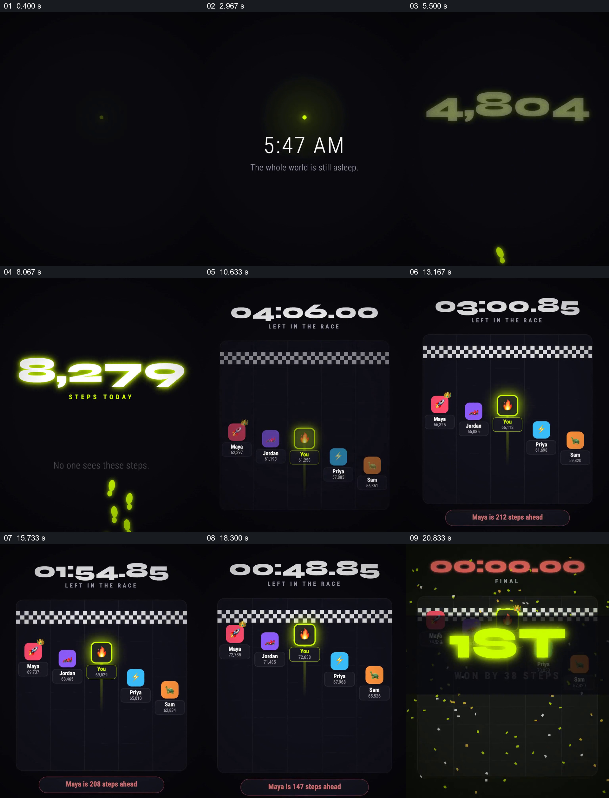

# 把清晨个人步数变成临近终点的多人较量

- 作品：案例 067（库内案例）。
- 原片范围：0.000–23.000 秒；[原片](../video.mp4)｜[片段](c01.mp4)。含起点、不含终点。
- 观察方式：查看全片 64 格与本卡九宫格；未独立原速连续观看或听审，动作衔接、数据及迁移未核实。

## 原画面具体怎样设计

黑底先有微弱亮点，中央显示 5:47 AM，随后荧绿大数字显示当日步数增长，脚印与“No one sees these steps”陪衬。画面切到排行榜，顶部大号倒计时、其下黑白格终点线，五个不同颜色参与者标记与步数排列在赛道中；“You”用荧绿边框突出，领先者 Maya 的标记带皇冠，底部短条显示领先步数差。

抽样显示时间由约四分钟降至零，几个头像和数字位于不同高度，差距文字同步换值。最后时间归零，荧绿“1ST”覆盖排名，保留“WON BY 38 STEPS”和彩纸。个人步数、他人进度、剩余时间和最终结果围绕同一竞赛接续。

## 为什么这样设计，好在哪里

先给出独自累积的步数，再揭示别人也在同一场比赛里，原本孤立的数字获得比较对象；终点线和倒计时让名次具备共同结束条件，亮边框帮助观众始终定位自己，底部差距使领先关系可读。最终大字与具体差距一同出现，使“第一”不只是装饰。人物与数字是演示画面，真实性未核实。

## 可直接使用的创意指令

选择真实可用、经授权的参与者与统一计量指标，先建立个人当前状态，再把他与其他参与者放到同一个终点与截止时间下；保持各人身份、实时数值和领先差距可追踪。结束时保留最终名次及差值，确保时间、排序和数字由同一份数据驱动；人物图标、颜色和竞赛形式可按内容改变。
