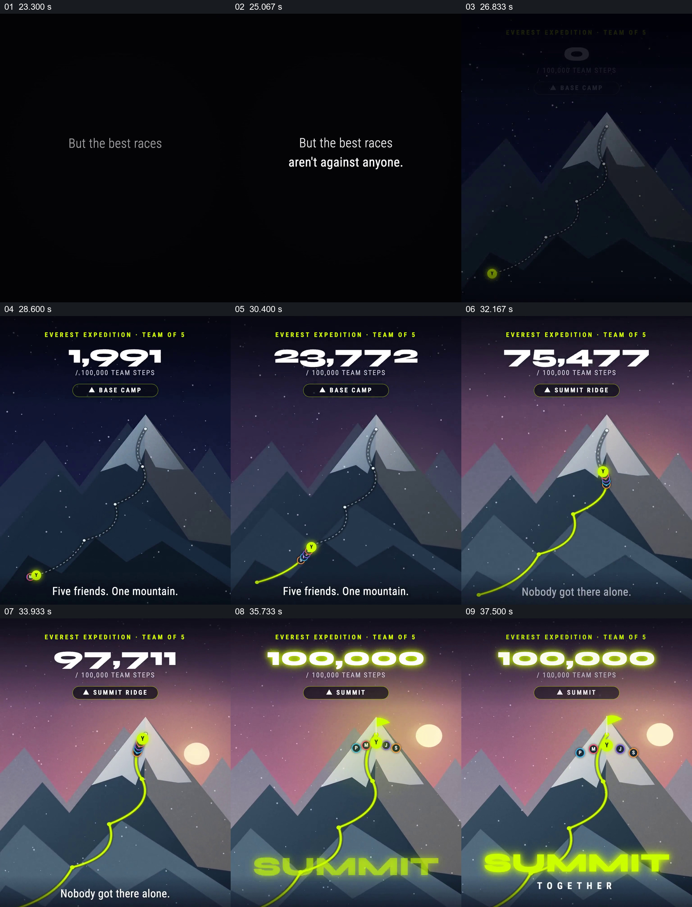

# 把多人贡献合成一条通向山顶的路线

- 作品：案例 067（库内案例）。
- 原片范围：23.000–39.000 秒；[原片](../video.mp4)｜[片段](c02.mp4)。含起点、不含终点。
- 观察方式：查看全片 64 格与本卡九宫格；未独立原速连续观看或听审，动作衔接、数据及迁移未核实。

## 原画面具体怎样设计

上一场个人比赛结束后，黑底文字提出“最好的比赛不是对抗任何人”。夜色山峰占据中央，山脚到峰顶有一条虚线路径，顶部显示五人团队及 0/100,000 的总步数；一个荧绿成员标记先在起点，随后其他标记叠在附近。

顶部数值上升的同时，亮黄色路径从山脚沿虚线路线向上延伸，成员标记伴随路径到达不同高度；地点牌从 BASE CAMP 变为 SUMMIT RIDGE 等阶段，背景由深蓝渐向日出暖色。到 100,000 时路线到达山顶，五个成员标记展开在峰顶旗帜周围，底部出现“SUMMIT TOGETHER”。

## 为什么这样设计，好在哪里

同一条路径把多人的数字变成一个可见目标，顶端总步数与路线长度相互解释；成员先相叠、最后分布在共同终点，使集合仍能识别为多人参与。它与前段名次对照，从谁领先转到大家共同完成，但本卡仍能独立理解。示例并不证明现实中的团队实际完成了活动。

## 可直接使用的创意指令

确认团队各自的贡献如何被计入同一总量，先显示清晰的起点、终点与目标数；让总数和路径进度由同一数据驱动，沿途用少量有意义的阶段名称定位。目标完成时在终点同时保留参与者标记与总值，使“共同完成”能被看见。山和旗帜可换成适合新项目的空间隐喻，成员数据和展示权限应真实可核查。
