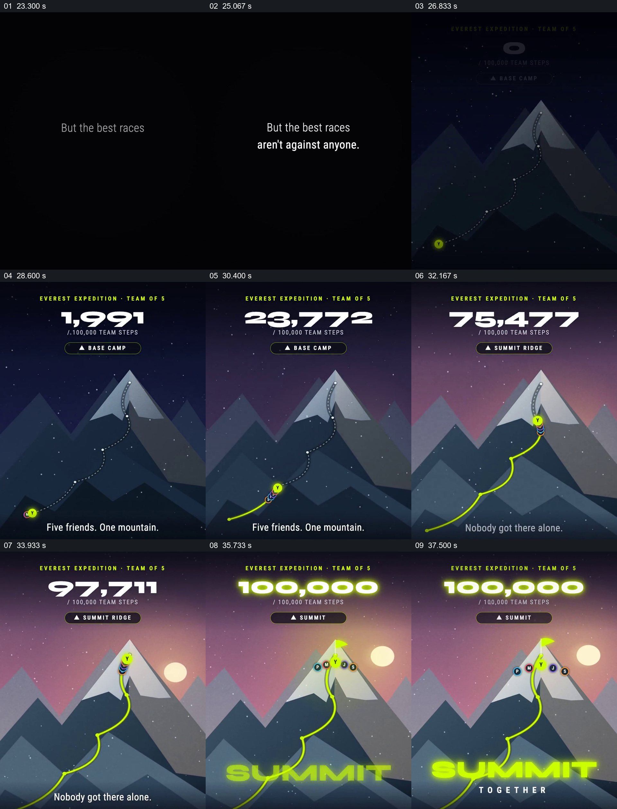

# 把多人贡献合成一条通向山顶的路线

- 作品：案例 067（库内案例）。
- 原片范围：23.000–39.000 秒；[原片](../video.mp4)｜[片段](c02.mp4)。含起点、不含终点。
- 观察方式：查看全片 64 格与本卡九宫格；未独立原速连续观看或听审，动作衔接、数据及迁移未核实。

## 原画面具体怎样设计

上一场个人比赛结束后，黑底文字提出“最好的比赛不是对抗任何人”。夜色山峰占据中央，山脚到峰顶有一条虚线路径，顶部显示五人团队及 0/100,000 的总步数；一个荧绿成员标记先在起点，随后其他标记叠在附近。

顶部数值上升的同时，亮黄色路径从山脚沿虚线路线向上延伸，成员标记伴随路径到达不同高度；地点牌从 BASE CAMP 变为 SUMMIT RIDGE 等阶段，背景由深蓝渐向日出暖色。到 100,000 时路线到达山顶，五个成员标记展开在峰顶旗帜周围，底部出现“SUMMIT TOGETHER”。

## 为什么这样设计，好在哪里

同一条路径把多人的数字变成一个可见目标，顶端总步数与路线长度相互解释；成员先相叠、最后分布在共同终点，使集合仍能识别为多人参与。它与前段名次对照，从谁领先转到大家共同完成，但本卡仍能独立理解。示例并不证明现实中的团队实际完成了活动。

## 完整照排指令

以[完整原片](../video.mp4)的 23–39 秒为准。画幅 1024×1280，源帧率 30/1。以下拍点为抽帧定位，位置按画幅百分比取近似值。

### 源时刻照排

- 23–约 26 秒，竖屏黑底中部用两行【团队引子】接上一场，第二行逐步显现。字退后夜色【山峰剖影】铺满中下区域，虚线从左下起点绕上至画幅上部雪峰。
- 约 26–35 秒，顶部固定荧绿小号【活动标题】及大白字【团队累计值】，下一行写小号【团队目标值】，其下深底【路线阶段牌】。先给荧绿【成员标记】在山脚起步，再加入其他成员；荧绿【进度线】紧贴虚线从起点逐步长出，标记随累计向上移动，前方保留虚线。背景由深蓝渐暖，底部【协作短句】按进程更换。
- 约 35–39 秒，累计到目标，顶部数字发荧光，峰顶出现亮旗，成员在旗杆周围横向展开，底部覆盖巨幅荧绿【达成标题】与小白字副行。保留完整路径后淡出。

### 用料与取用

【山峰剖影】需提供分层山脊、日夜天空及一条从左下连续到峰顶的路径。【进度线】【成员标记】从约 26 秒持续到 39 秒，基于同一组成员和累计坐标，不能用循环、定格或照片运镜替代到达；终态可短停。交同一次活动的【团队累计值】【团队目标值】与各【路线阶段牌】门槛表，数值扣合已点亮路线、聚集人数和到顶时刻。【团队引子】【活动标题】【协作短句】【达成标题】供可独立排入两行的短文，若用真实地理或成绩，交可核对的地理名称或活动记录。仅有一段连续累计可独立取约 26–35 秒，直接从已知阶段开始，不显示未证实的到顶；仅有结果记录可用约 35–39 秒，呈现已有满程和成员合照状态。

### 验证状态

已对照原片等距抽帧与卡稿，核查阶段牌随累计、同一路径持续、成员展开与峰顶达成。准确切点、原速听看与换料试摆待核。
