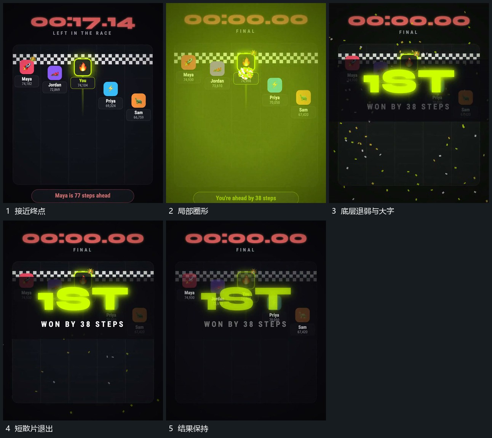

# 局部圈形接入，底层退弱，大字缩回前景，散片短促退出

## 运动指令

小片到终点后接入局部圈形，底层整体退弱。前景大字以较大尺度出现，再缩回目标位置，附属行补齐；短散片经过后退出，大字与结果底层保持。

## 视频切片

[播放本机制的原片切片](m03.mp4)

覆盖分镜中“接近终点”至“结果保持”的连续过程，并保留邻近的前后衔接画面；原片中交叠发生的动作一并保留。

## 分镜过程

## 组合与调整

结果不继承原名次，反馈应对应本片明确完成状态。
