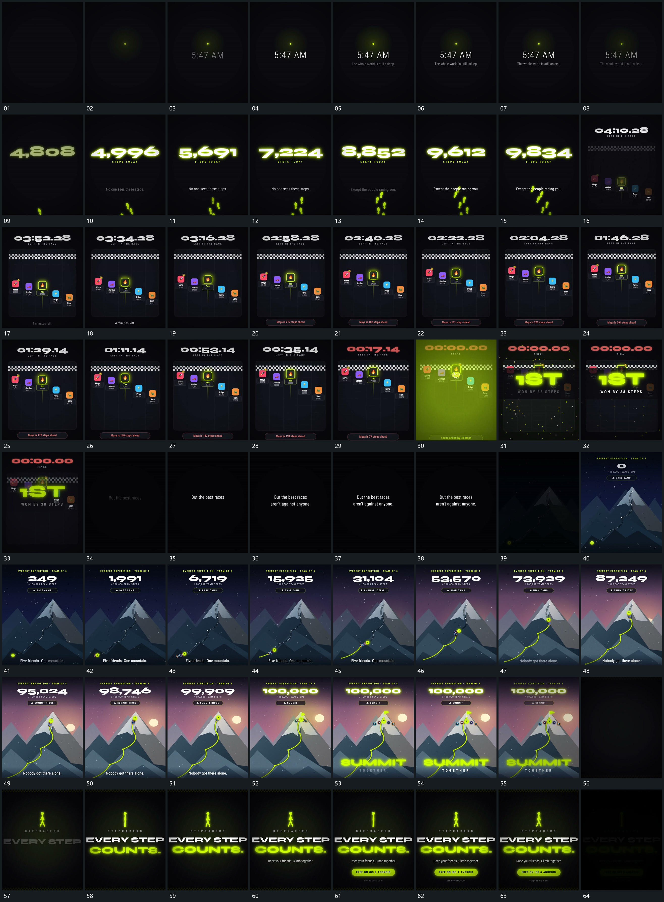

# 067｜原片运动总览

[观看完整原片](video.mp4)

## 运动总览

开头点与短字建立，字组退去后 中央数值增长，成对小形错开上移并越过边缘 中央大数值持续增长，下方成对小形错开上移并越界。多个小片沿独立竖轨上移，位置超越时保持来源轨迹 固定大框中多个小片沿各自竖向轨迹上移，数值增加，上方另一数值递减，位置关系发生超越。

终点 局部圈形接入，底层退弱，大字缩回前景，散片短促退出 局部圈形反馈接入，底层退弱，大字由大缩回到前景，短散片经过后退出。字组接替后 小片群沿虚线前进，实线在经过处延长，数值增长 在固定空间沿虚线轨迹推进小片群，已经过路径延长实线，顶部数值增加。到站后末端标记建立，片群展开到两侧，下字接上 路径到终点时末端标记建立，片群展开到其两侧，下方大字随后接入。结尾主形、分行字组与底条逐项建立，整体退暗。

## 完整运动段落

以下按原片中的出现顺序引用。建立、内部发展及完成反馈放在同一段中；同时发生的局部动作与运镜写在同一份指令里。不同段之间可以是连续接管，也可以是直接切换，不能仅凭条目相邻认定可直接拼接。重复出现的同类运动采用一次连续代表范围，切片不以逐段无缝覆盖整片为目标。

1. [中央数值增长，成对小形错开上移并越过边缘](mechanisms/m01.md)：数值原位，外围成对形运动

2. [小片沿竖轨竞相上移，结束时前景大字与散点反馈接管](mechanisms/m06.md)：各小片沿独立竖轨前进，超越时不改变来源轨迹；到终点后局部圈形接入，底层退弱，大字与散片完成反馈。

3. [沿虚线推进留下实轨，抵达末端后散开并补齐收尾](mechanisms/m07.md)：小片群沿路径前进，经过处留下实线且数值增长；抵达末端后建立终点标记，片群向两侧展开，下方字组接上。

切片保留起始准备、必要内部停顿和完成或明确交接；首尾省略无新发展的等待，持续运动不要求人为停住。以上基于真实源帧序列和重点边界核对，不等同于全片连续声画审片。

## 完整64宫格

