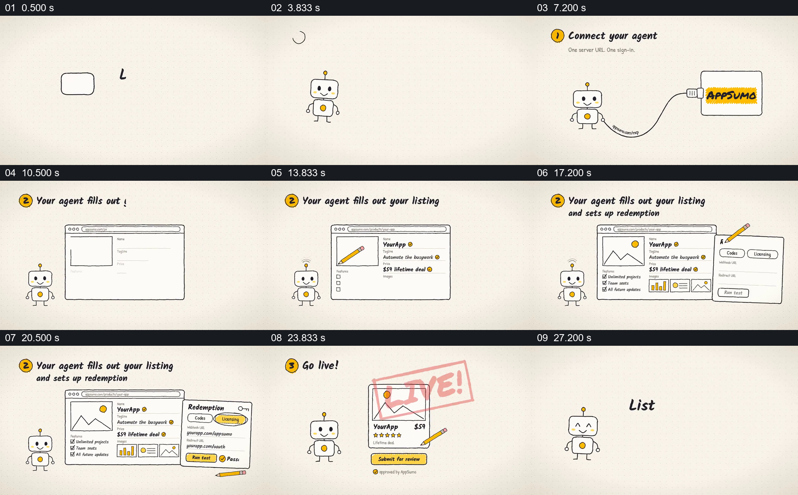

# 让同一机器人陪同一份商品信息走过三个上架步骤

- 作品：案例 077《智能体协助商品上架》（本次概括）。
- 原片范围：00:00.000–00:30.000，含起点、不含终点；[完整原片](../video.mp4)｜[本卡片段](../video.mp4)。
- 观察方式：依据约每秒一次的真实源帧观察，未连续原速观看或听审；声音、语气与完整播放节奏未确认。

## 原画面具体怎样设计

米色背景上机器人与标题先说明三步上架；第一步中机器人用线缆连接平台标志并显示 Connected。第二步换成空白商品页面，铅笔依次填写名称、价格、图片和清单，旁边展开兑换设置并显示通过。第三步商品卡出现，铅笔指向提交，页面盖上 LIVE，随后出现销售提示；最后回到机器人及行动文字。

## 为什么这样设计，好在哪里

机器人贯穿不同页面，商品卡则从空白逐步累积到提交，使三步指向同一个结果；线缆、铅笔和状态标识为抽象的连接与填写提供可见动作。画面属于产品宣传示意，不代表已发生的真实销售。

以上为依据画面的分析，非作者自述；预期观看效果未经观众测试。

## 可直接使用的创意指令

演示助手参与的提交任务时，选一份真实或明确标示的示例资料，让同一助手贯穿连接、填写、必要设置与最终提交；保持表单中已填内容并展示每一步的确认状态，说明哪些步骤需用户审核。交互和结果应符合实际产品能力，不把示意反馈写成真实业绩。
