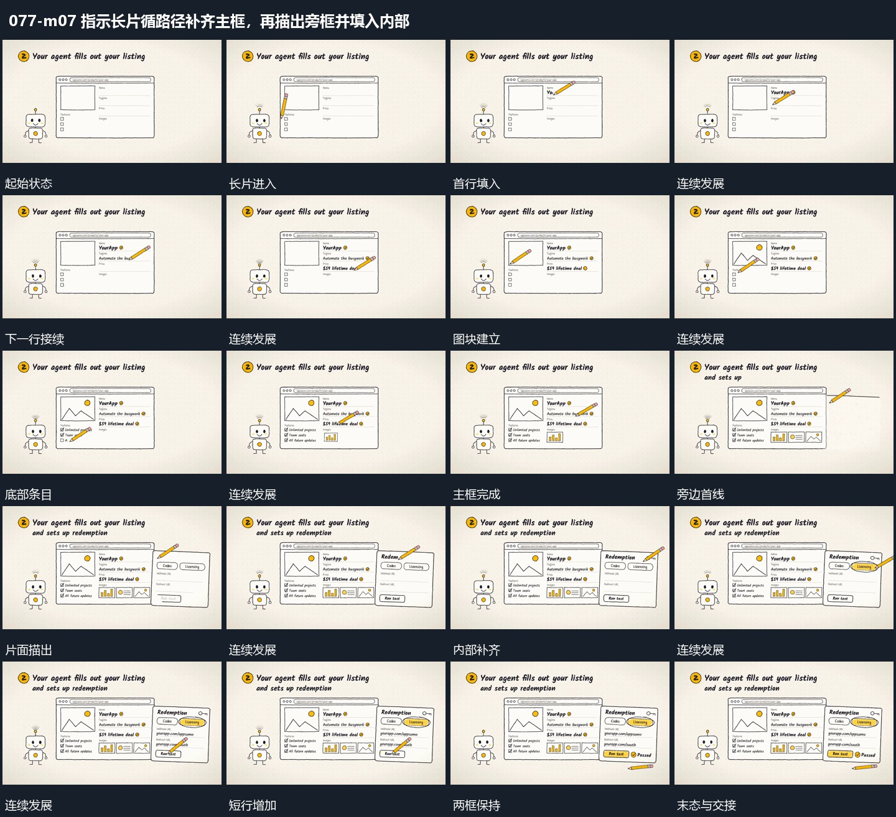

# 指示长片循路径补齐主框，再描出旁框并填入内部

## 运动指令

主框已建立，指示长片沿局部路径经过留下填充；主框保持，旁面轮廓继续描出，内部短条与形状逐项补齐。

1. **指示长片沿局部经过并留下逐项填充**

让细长指示片以尖端对准首个空区，沿局部行走过，字行在其经过后逐步留下。完成一处后转向下一处，再建立图块和底部条目；已填部分不擦除，外框与左侧小形保持。末尾长片离开主区。

2. **主框保持旁侧片面再被描出并补内部**

保留主框原位，在旁侧从短线开始描出另一片面的边界，片面带轻微倾角。边界闭合后先加入顶部小框，再依次补字行与底部条，填入动作沿同一指示长片接续。完成后让两片面共同保持。

整段结束：右片面完整并与主框并置 保留必要落稳与交接，中间已建立的参照沿用到下一步骤。

## 视频切片

[播放本机制的原片切片](m07.mp4)

保留起始准备、连续发展和完成或明确交接；首尾按本段运动范围裁切，不拼接、不变速。相连的小动作合为同一完整段落。

## 分镜过程

## 组合与调整

主框已建立，指示长片沿局部路径经过留下填充；主框保持，旁面轮廓继续描出，内部短条与形状逐项补齐。 复用时可调整元素数量、幅度和相对节奏，保留上述进入、交叠与完成关系；不直接沿用原片题材或时长。

可更换填入内容，保留尖端和填充位置的关联；不同区域间需要可见转向。

调整旁片大小即可；新增区不应把主框原有条目重新打散。
