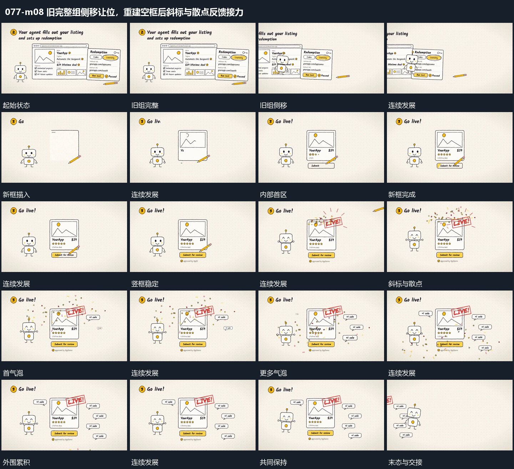

# 旧完整组侧移让位，重建空框后斜标与散点反馈接力

## 运动指令

旧组完成后侧移，保留小形作为锚点；新空框重新建立并填入，斜标叠入，散点向外扩展，小气泡继续累积。

1. **完成组侧移保留小形后重新建立空框**

先让旧片面组整体横向移开，小形跟随过渡到新位置。旧组退出时在小形旁重新描出下一空框，完成外边界后再补内部区块；小形一直作为邻接参照，避免阶段之间完全退空。

2. **斜标接入后散点外放小气泡逐次累积**

在竖框上缘接入带倾角的短标，接入处的小点向外分散再下落。随后在框旁逐次加入小气泡，各气泡出现后保持位置，使数量累积。框和底条始终稳定，小形可作局部抬起与落回。

整段结束：斜标与多气泡分布在框旁 保留必要落稳与交接，中间已建立的参照沿用到下一步骤。

## 视频切片

[播放本机制的原片切片](m08.mp4)

保留起始准备、连续发展和完成或明确交接；首尾按本段运动范围裁切，不拼接、不变速。相连的小动作合为同一完整段落。

## 分镜过程

## 组合与调整

旧组完成后侧移，保留小形作为锚点；新空框重新建立并填入，斜标叠入，散点向外扩展，小气泡继续累积。 复用时可调整元素数量、幅度和相对节奏，保留上述进入、交叠与完成关系；不直接沿用原片题材或时长。

侧移方向可改，下一框的描入应在旧组退出过程中开始，而非等待全空后另起画面。

散点只需一次发起；气泡错开出现，留出清楚边界，避免遮住同一主区。
