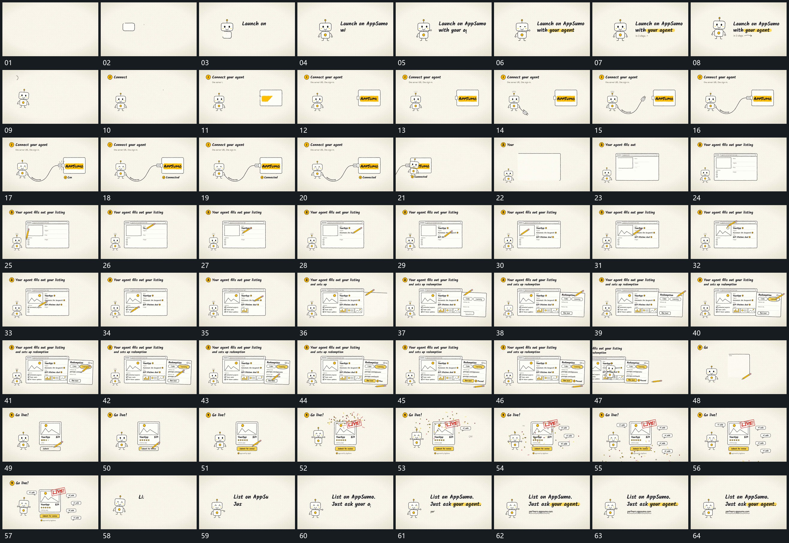

# 077｜原片运动总览

[观看完整原片](video.mp4)

## 运动总览

全片以小轮廓逐段描出短行逐字补齐再划线建立小轮廓和逐字短行，再换到左右两组，由曲线端头从左组延伸并对准右框接合延伸曲线接上右框。之后指示长片沿局部经过并留下逐项填充沿多个局部连续填入，已填项保持；主框保持旁侧片面再被描出并补内部在主框旁再描出第二片面，并继续复用指示长片沿局部经过并留下逐项填充。

阶段切换时完成组侧移保留小形后重新建立空框将完成组移出，保留小形并给下一框重新留空。末段竖框完成后以斜标接入后散点外放小气泡逐次累积加入斜标、向外散点和逐项小气泡。最后回到小形与短行，复用小轮廓逐段描出短行逐字补齐再划线的分项建立与下划线收束。

## 完整运动段落

以下按原片中的出现顺序引用。建立、内部发展及完成反馈放在同一段中；同时发生的局部动作与运镜写在同一份指令里。不同段之间可以是连续接管，也可以是直接切换，不能仅凭条目相邻认定可直接拼接。重复出现的同类运动采用一次连续代表范围，切片不以逐段无缝覆盖整片为目标。

1. [小轮廓逐段描出短行逐字补齐再划线](mechanisms/m01.md)：描边与补字错开完成

2. [曲线端头从左组延伸并对准右框接合](mechanisms/m02.md)：伸展后端头对齐

3. [指示长片循路径补齐主框，再描出旁框并填入内部](mechanisms/m07.md)：主框已建立，指示长片沿局部路径经过留下填充；主框保持，旁面轮廓继续描出，内部短条与形状逐项补齐。

4. [旧完整组侧移让位，重建空框后斜标与散点反馈接力](mechanisms/m08.md)：旧组完成后侧移，保留小形作为锚点；新空框重新建立并填入，斜标叠入，散点向外扩展，小气泡继续累积。

切片保留起始准备、必要内部停顿和完成或明确交接；首尾省略无新发展的等待，持续运动不要求人为停住。以上基于真实源帧序列和重点边界核对，不等同于全片连续声画审片。

## 完整64宫格

