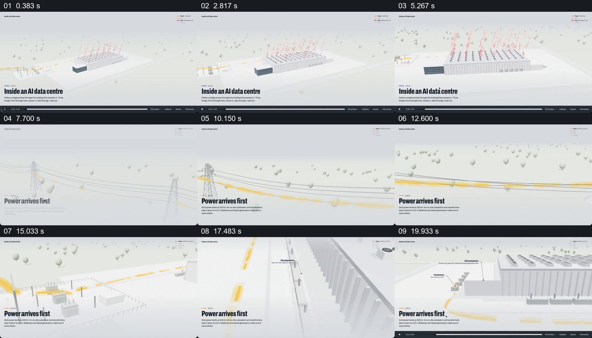

# 先建立数据中心，再沿电网路径进入供电设施

- 作品：案例 094《数据中心三维说明》。
- 原片范围：00:00.000–00:22.000（源时间，起点包含、终点不包含）；[完整原片](../video.mp4)｜[本卡片段](c01.mp4)。复用已有同范围切片与源帧分镜。
- 观察方式与未确认范围：查看全片 64 帧总览及本卡分镜；80 秒前后另以约 0.1 秒间隔核对交接源帧。未独立完成连续原速观看与听审，精确运动、停顿、声音及同步未知；技术事实和迁移效果均未独立验证。

## 原画面具体怎样设计

浅灰白环境里，长条数据中心占据中间，远处稀疏树木、左侧电网和屋顶红色排热标记共同建立整体；左下标题写“Inside an AI data centre”，右上角小图例用不同颜色区分路径。建筑仍然较小，重点是先认识一个设施及其周边。

约 00:07，观察位置转到外部输电塔和电线，一条黄色路径沿线显现，左下标题变为“Power arrives first”。随着观察范围沿线路向设施方向变化，黄色标记延伸到带设备的变电区域，随后出现贴近建筑的发电机、变压器与 UPS／电池标注；建筑外墙和连接路线仍在同一空间中。约 00:20，黄色路径靠近建筑，观众可以看到线路、节点和建筑的相对位置，之后进入机房。

## 为什么这样设计，好在哪里

开场先把数据中心作为目的地建立，再把注意力移到它外部的供电线路；黄色路径在灰白环境中明显可见，让观众从线路追到多个节点，而非只看一张标着“电力”的抽象图。建筑、树木和设备的共同空间提供尺度与方向，标签只在具体设施附近解释角色。

观察位置的变化服务于同一条路径：远景交代哪里接入，靠近时再看经过哪些设施。具体电压、备电方式及先后顺序是片中示意，未独立验证，不能将颜色动画当作实际工程证据。

## 可直接使用的创意指令

解释一项基础设施的外部输入时，先用真实地图、模型或影像建立目的地及周边，再选择一条有依据的输入路径；让路径与实际线缆、管线或道路保持可辨的空间对应，并在经过关键节点时提供简短标签。

从远处到近处逐步改变观察范围，保留目的地或路径中的至少一个参照，最终到达设施入口。颜色、摄影角度、画幅和模型表现可调整，关键关系是“外部来源—中间节点—设施入口”能够被追踪。没有工程数据时明确作为概念示意，不根据动画推断真实电压、容量或供电可靠性。
