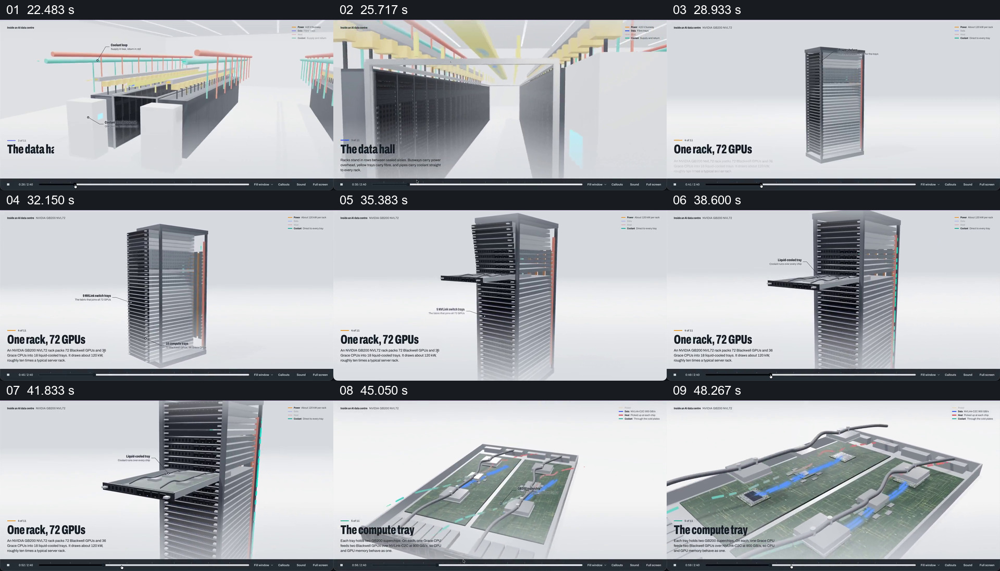

# 从机房穿到机柜，再抽出一层计算托盘

- 作品：案例 094《数据中心的空间与结构》（本次概括）。
- 原片范围：00:22.000–00:51.000，含起点、不含终点；[完整原片](../video.mp4)｜[本卡片段](c02.mp4)。
- 观察方式：依据约每秒一次的真实源帧观察，未连续原速观看或听审；声音、语气与完整播放节奏未确认。

## 原画面具体怎样设计

画面进入成排机柜之间，再将一只机柜单独置于浅背景；机柜旋转并显示侧面结构，一层托盘向外抽出。画面切到托盘俯视，蓝色标记逐渐出现，最后靠近板上的芯片及红蓝线路。标题分别指向数据大厅、单机柜和计算托盘。

## 为什么这样设计，好在哪里

先在整体中建立机柜，再单独抽出一层，使读者能够把局部结构放回其原来位置；不断缩小观察尺度为芯片讲解做好前置。数量与内部构造均为片中示意，未独立验证。

以上为依据画面的分析，非作者自述；预期观看效果未经观众测试。

## 可直接使用的创意指令

解释大型设备内部构造时，先在整体环境定位目标，再隔离完整单元并显示局部如何从中取出；保持一致的外形或方向线索，逐步放大到有依据的组件。实际设备结构和数量应依据来源制作。
