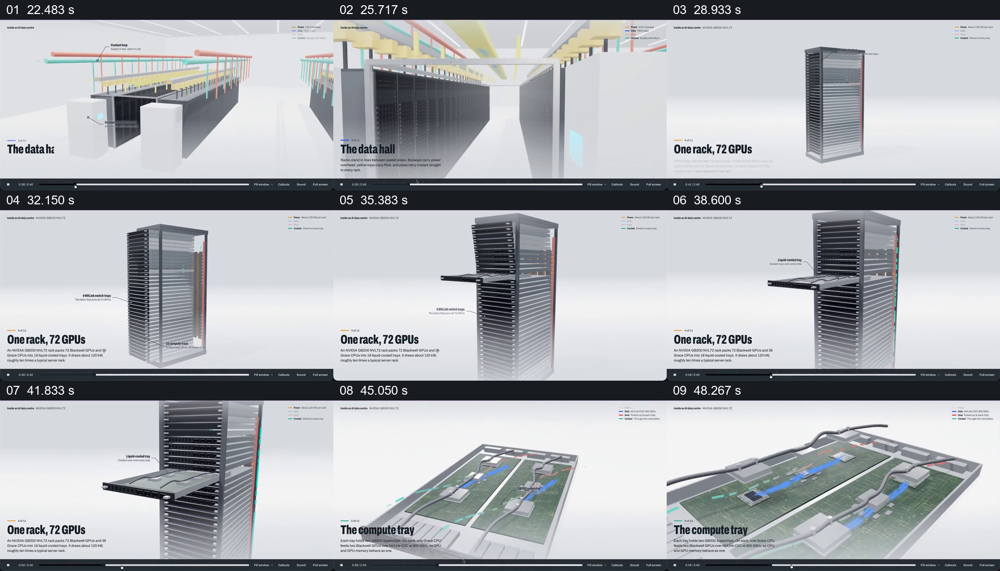

# 从机房走向单个机柜，再把计算托盘交给观众

- 作品：案例 094《数据中心三维说明》。
- 原片范围：00:22.000–00:51.000（源时间，起点包含、终点不包含）；[完整原片](../video.mp4)｜[本卡片段](c02.mp4)。复用已有同范围切片与源帧分镜。
- 观察方式与未确认范围：查看全片 64 帧总览及本卡分镜；80 秒前后另以约 0.1 秒间隔核对交接源帧。未独立完成连续原速观看与听审，精确运动、停顿、声音及同步未知；技术事实和迁移效果均未独立验证。

## 原画面具体怎样设计

约 00:22，观察位置处于数据中心内部：深色机柜分列在白色通道两侧，顶部有黄色、红色和青色线路；左下说明为“The data hall”。随后观察范围从机柜排之间转到一个独立机柜，背景变得简洁；机柜内有多层横向托盘，侧面可见不同颜色的竖向连接。

约 00:35，一层托盘从机柜正面伸出，机柜其余层仍留在后面；下方继续显示单机柜和 GPU 数量的片中文字。到约 00:42，抽出部分的面积足以观察内部，接着托盘单独成为主要画面：两块电路板、浅色方形部件和管线共同显露，彩色路径及标注指向板上局部。

## 为什么这样设计，好在哪里

机房、单个机柜与一层托盘形成逐级关系：先看到“很多”，再看到“其中一个”，最后看“这个机柜里的一层”。托盘伸出时其余机柜结构仍作为参照，使观众容易理解部件的原位置；如果一开始直接展示电路板，无法从画面知道它属于哪一层设备。

背景简化和对象面积的变化共同控制注意力；不同颜色的连接线在托盘放大后仍帮助区分不同路径。型号、数量和数据吞吐等都是作品内的技术说明，未据该动画独立核实。
