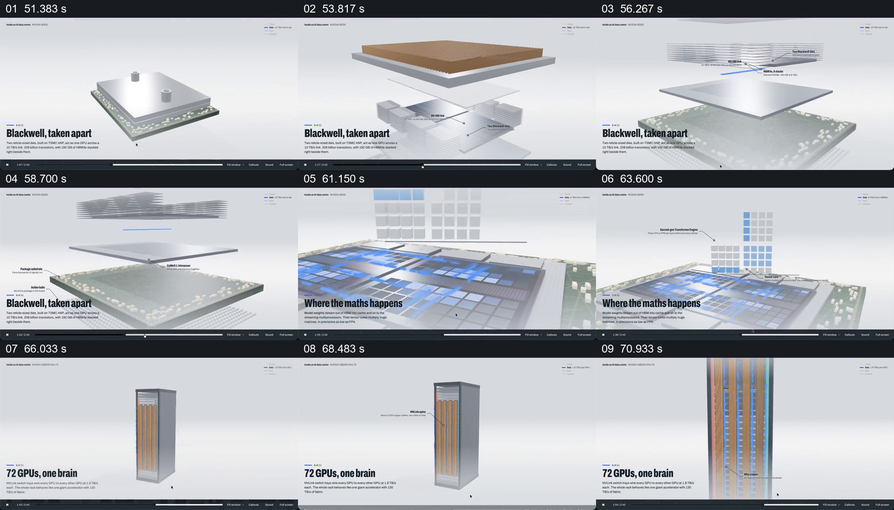

# 从芯片分层到计算方格，再回到机柜内部连接

- 作品：案例 094《数据中心三维说明》。
- 原片范围：00:51.000–01:13.000（源时间，起点包含、终点不包含）；[完整原片](../video.mp4)｜[本卡片段](c03.mp4)。复用已有同范围切片与源帧分镜。
- 观察方式与未确认范围：查看全片 64 帧总览及本卡分镜；80 秒前后另以约 0.1 秒间隔核对交接源帧。未独立完成连续原速观看与听审，精确运动、停顿、声音及同步未知；技术事实和迁移效果均未独立验证。

## 原画面具体怎样设计

约 00:51，一块方形封装和底板处于浅灰背景中央。之后上方盖板、棕色层、薄片和底部基板在竖直方向分开，不同层附近出现细线标签；它们上下保持对齐，仍能看出原本属于同一块封装。

随后观察范围靠近芯片平面，蓝色方格和发亮的路径出现在内部，画面上方另有由灰蓝方格组成的矩阵及引线说明。约 00:66，芯片细节让位给一个高而窄的机柜；橙色竖线和蓝色标记出现在柜体中，画面进一步靠近这些线束，左下文字由芯片解释转到“72 GPUs, one brain”。

## 为什么这样设计，好在哪里

分层画面先保持零件垂直对位，再以标签指向不同层，让观看者可以比较它们的位置；随后用方格和蓝色路径把注意力转向片中想解释的计算活动。机柜重新出现，把观察尺度从芯片内部带回到更大的设备。

这里的价值来自不同尺度之间仍有对象身份：封装是一个整体，分开后各层仍对齐，回到机柜时又有线束作为连接对象。动画中的芯片结构、计算方式和带宽指标均是作品呈现，未经独立核验；相邻抽帧不能证明每个层级之间的精确运动或真实工程比例。

## 可直接使用的创意指令

需要解释内部结构和外部连接时，先准备同一部件的整体外观、可信层级资料，以及其所在设备的上下文。分层时保留原本的对位方向，让每一层能够在整体中被放回；标签指向实际位置，计算或能量示意应与它所代表的层级区分。

解释内部后，再回到部件所在的设备，用清楚的线束、接口或其他真实连接承接更大尺度。外形、色彩、拆解方向和是否使用方格可替换；不要丢掉“这些层属于同一对象”和“对象位于更大系统中”的关系。没有真实依据时注明简化示意，不把示意连接当成实际布线。
