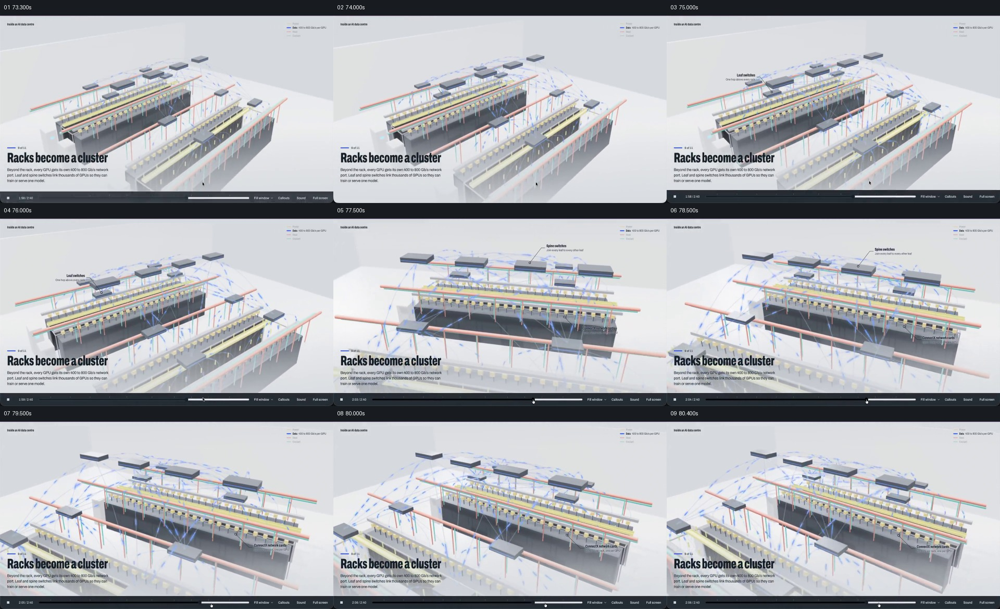

# 保留多排机柜，以蓝色路径显露它们如何形成网络

- 作品：案例 094《数据中心三维说明》。
- 原片范围：01:13.000–01:20.500（源时间，起点包含、终点不包含）；[完整原片](../video.mp4)｜[本卡片段](c04-20261111.mp4)。该原片为变帧率；本次按源帧确定边界并新做切片与分镜。第四、五卡重叠 0.1 秒保留网络到冷却的交接。
- 观察方式与未确认范围：查看全片 64 帧总览及本卡分镜；80 秒前后另以约 0.1 秒间隔核对交接源帧。未独立完成连续原速观看与听审，精确运动、停顿、声音及同步未知；技术事实和迁移效果均未独立验证。

## 原画面具体怎样设计

源片约 00:73，画面从单个机柜内部转为斜上方的机房视图：几排深色机柜排列在白色空间，顶部有黄色、红色和青色线路，若干深色矩形设备位于机柜上方。左下标题为“Racks become a cluster”，右上角以蓝色图例表示数据。

接下来的源帧里，细蓝线连接机柜与上方设备，箭头状短线分布在多条连接附近；局部标签先指向一处交换设备，随后在其他位置显示不同交换设备和网络卡。视角变得更靠近机柜群时，多个机柜仍同时留在画面中；至约 00:80.4，网络结构和多条线路仍可见，之后进入冷却示意。

## 为什么这样设计，好在哪里

机柜群没有因解释网络而全部消失，交换设备和线条直接与同一空间中的不同机柜对应，因此观众能先看见节点，再看见节点之间的关系。蓝线相对灰白环境更醒目，标签一次指向局部，避免把所有节点都写成一张密集清单。

如果只给出“集群”这个词，观众不知道哪些机柜被连接；如果所有线路脱离设备独立显示，也会失去它们在机房中的位置。这里仅分析画面表达，不证明其网络拓扑或速率准确。

## 可直接使用的创意指令

需要让多个设备形成可理解的网络时，先建立足够清楚的节点空间和相对位置，再加入有依据的连接路径；用颜色、线条或方向标记区分不同关系，并让解释标签靠近实际节点。每次只强调能回答当前问题的一个连接或一组节点，其他对象作为持续参照。

网络建立后保留一个能看清整体关系的结果，再交给下一项独立表达。节点形态、背景、线色和观察角度可变；不能丢失“线的两端分别属于什么”及多个节点共同形成系统的关系。没有可靠拓扑时以示意形式标注，不用虚构箭头或速率冒充真实网络。
