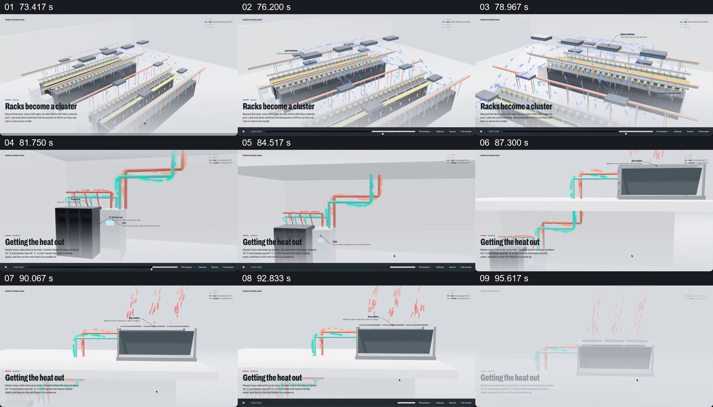

# 从机柜群连接到冷却排热

- 作品：案例 094《数据中心的空间与结构》（本次概括）。
- 原片范围：01:13.000–01:37.962，含起点、不含终点；[完整原片](../video.mp4)｜[本卡片段](c04.mp4)。
- 观察方式：依据约每秒一次的真实源帧观察，未连续原速观看或听审；声音、语气与完整播放节奏未确认。

## 原画面具体怎样设计

多排机柜和顶部线路组成集群，镜头显示其整体排列；接着聚焦单个机柜上方的红绿管路，沿管路移动到外部箱体。箱体顶部出现向上的红色热流，最后回到整个设施与“电力进入、输出、热量带走”的总结。

## 为什么这样设计，好在哪里

从成排设备到管线再到外部排热，保留了能源与热管理跨越空间的可见路径；末尾总览把局部还原成系统。冷却流向和实际工程条件需独立核实。

以上为依据画面的分析，非作者自述；预期观看效果未经观众测试。

## 可直接使用的创意指令

介绍设备群的冷却关系时，先定位产生热量的设备群，沿实际管路展示连接的冷却与排热设施，保留进出方向和前后状态，最后回到整体系统。颜色、箭头只是辅助，具体流向与条件必须依据工程资料。
