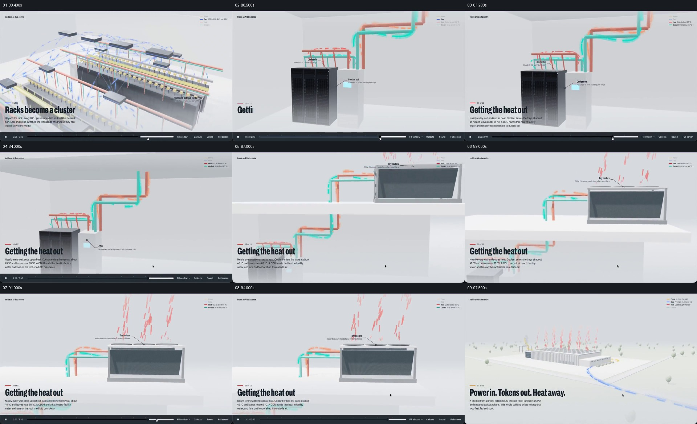

# 沿机柜旁的冷热管线向上，最后看到屋顶排热

- 作品：案例 094《数据中心三维说明》。
- 原片范围：01:20.400–01:37.962（源时间，起点包含、终点不包含）；[完整原片](../video.mp4)｜[本卡片段](c05-20261111.mp4)。该原片为变帧率；本次按源帧确定边界并新做切片与分镜。第四、五卡重叠 0.1 秒保留网络到冷却的交接。
- 观察方式与未确认范围：查看全片 64 帧总览及本卡分镜；80 秒前后另以约 0.1 秒间隔核对交接源帧。未独立完成连续原速观看与听审，精确运动、停顿、声音及同步未知；技术事实和迁移效果均未独立验证。

## 原画面具体怎样设计

源片约 00:80.4 仍能看到机柜网络；随后画面交给黑色机柜和旁边浅色设备，青色与橙红色管线从机柜上方延伸，局部文字标注冷却液进入、流出及 CDU 等位置。不同颜色的管线并列，机柜本体留在画面下部作为起点。

观察范围随管线向上变化，屋顶平台和一台长方形设备进入画面；管线从下方空间连接到设备侧面。约 00:89 后，顶部出现红色向上短线，标签指向屋顶散热设备；左下标题为“Getting the heat out”。尾部观察范围回到建筑全景，顶部可见红色排热标记，同时保留不同颜色路径与总结文字。

## 为什么这样设计，好在哪里

这段先同时给出机柜、管线和旁侧设备，再沿可见管路交到屋顶，观众能把“哪里产生热”“通过什么路径”“最终从哪里排出”联系在一个空间里。青色与橙红色帮助区分片中设置的两类状态，但并不能代替明确标签或真实温度数据。

最后回到建筑外部，屋顶排热的位置重新落在整体尺度上；如果只展示风扇特写或漂浮的箭头，难以知道它与哪台设备相连。作品中的冷却结构、温度和路径均未独立核实。

## 可直接使用的创意指令

解释一条冷却、循环或排放路线时，先准备可信的设备、管路及出口关系；在同一画面内建立起点设备和它直接相连的管路，再沿路径切换到下一处，尽量让前一段管路在交接时仍可辨认。

以准确的标签、方向与单位区分进入、离开或不同介质，最终展示出口，并在适当情况下回到整体建筑或系统确认空间位置。颜色、材质、观察方向与图形可以重设，必须保留起点、路径、交接和结果之间的真实关系；没有足够工程依据时只作为明确的示意，不伪造温度、流向或处理效果。
