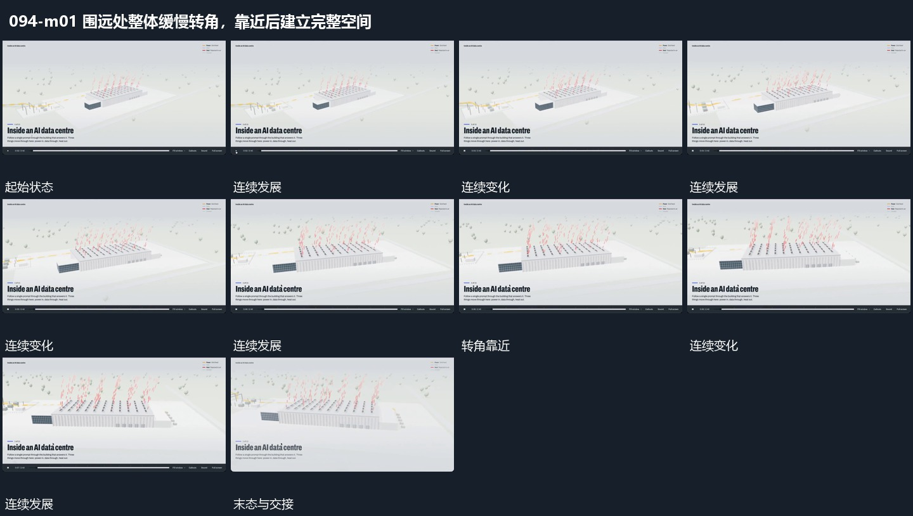

# 围远处整体缓慢转角，靠近后建立完整空间

## 运动指令

从能看见整个集合的远处开始，围绕同一中心缓慢改变观察角度并靠近。近侧边缘移动较快，远侧层移动较少；整体仍留在画面中，取景在共同结构建立后结束。

## 视频切片

[播放本机制的原片切片](m01.mp4)

保留起始准备、连续发展和完成或明确交接；首尾按本段运动范围裁切，不拼接、不变速。尾部只保留理解结果所需的展示。

## 分镜过程

## 组合与调整

保持空间参照，靠近时不要同时改变所有对象的相对位置。本段没有包含后面的通道穿行和返回。
