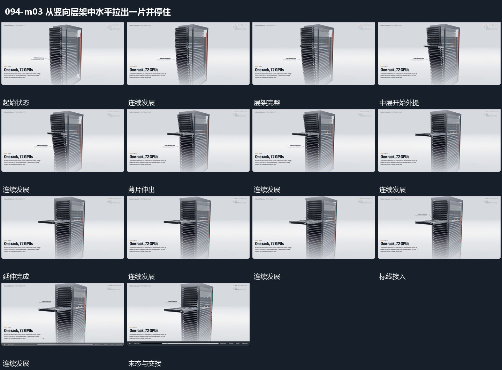

# 竖向层架中一片沿水平方向拉出并保持

## 运动指令

固定竖向层架，从中间一层把薄片沿自身平面水平拉出。其余平行片保持，外提片露出内部范围后停止，并从片上局部延出标线。后续取景可向外提片推进，层架边缘继续保留。

## 视频切片

[播放本机制的原片切片](m03.mp4)

覆盖分镜中“层架完整”至“外提保持”的连续过程，并保留邻近的前后衔接画面；原片中交叠发生的动作一并保留。

## 分镜过程

## 组合与调整

滑出方向要沿原层平面，不能整体缩放层架；无需继承原部件身份。
