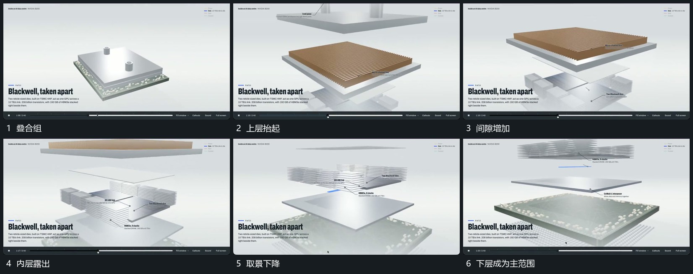

# 多层沿同一纵向分离再向下层转移取景

## 运动指令

保持各层平面方向，先抬起最上层，再沿同一纵向拉开中间层，使内层逐步露出。分离完成后各层保持相对间隙，取景沿层间向下移动，当前目标层逐步占据主要范围，标线从该层局部接入。

## 视频切片

[播放本机制的原片切片](m04.mp4)

覆盖分镜中“叠合组”至“下层成为主范围”的连续过程，并保留邻近的前后衔接画面；原片中交叠发生的动作一并保留。

## 分镜过程

## 组合与调整

层数可以减少，分离幅度不需一致；不要在取景下降中改变层的排列次序。
