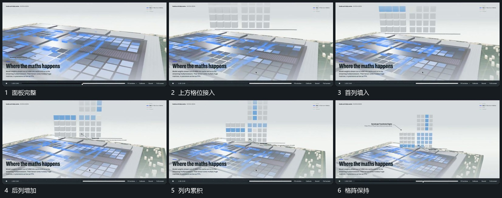

# 面板上方格阵建立标记沿列逐项填入

## 运动指令

面板保持，在其上方分次建立不同高度的竖向格列。格位建立后沿每列逐项填入标记，已填项保留，其他列错开接上。格阵完成后旁侧短标加入，底面仍有沿线路径经过。

## 视频切片

[播放本机制的原片切片](m05.mp4)

覆盖分镜中“面板完整”至“格阵保持”的连续过程，并保留邻近的前后衔接画面；原片中交叠发生的动作一并保留。

## 分镜过程

## 组合与调整

格列只是运动承载区，不要求继承图表含义；按列填入有清楚起点与结束项。
