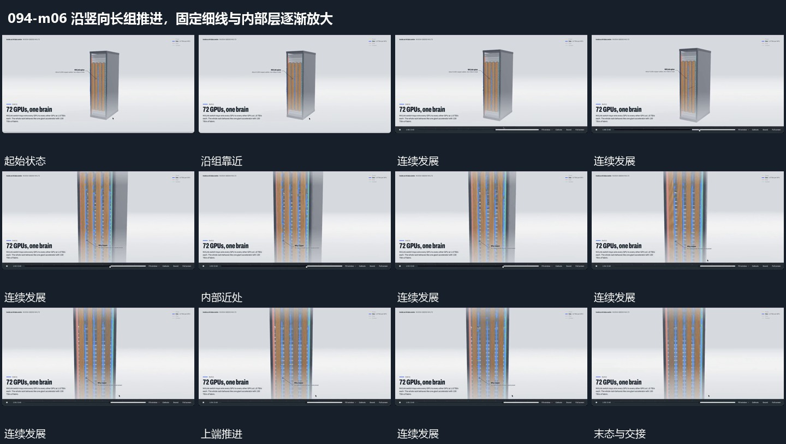

# 沿竖向长组推进，固定细线与内部层逐渐放大

## 运动指令

竖向长组保持完整，取景沿纵深推进到中央局部。外围边界逐渐越出画面，细长线与内部排列放大，原纵向关系不改变；近景稳定后结束，在换入下一集合前停止。

## 视频切片

[播放本机制的原片切片](m06.mp4)

保留起始准备、连续发展和完成或明确交接；首尾按本段运动范围裁切，不拼接、不变速。尾部只保留理解结果所需的展示。

## 分镜过程

## 组合与调整

推进围绕同一局部，不跳到新的对象重新开始；上抬到另一端不在本切片中。
