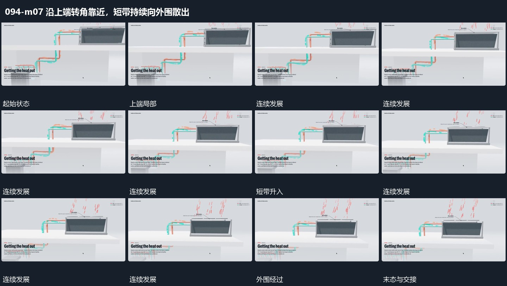

# 沿上端转角靠近，短带持续向外围散出

## 运动指令

围上端局部转角并靠近，固定连接仍保持；短带从上端接连向外送出，离开时拉开间距。取景落到较清楚的局部后继续保留一段散出，结束于仍可接续的运动状态。

## 视频切片

[播放本机制的原片切片](m07.mp4)

保留起始准备、连续发展和完成或明确交接；首尾按本段运动范围裁切，不拼接、不变速。尾部只保留理解结果所需的展示。

## 分镜过程

## 组合与调整

可改变短带数量与散出距离。本段为持续流动的代表范围，没有展示全部停止或减淡，不用额外等待伪造结束。
