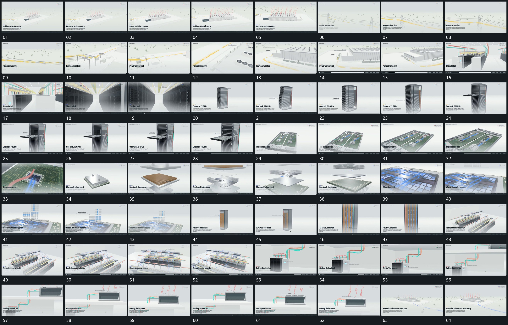

# 094｜原片运动总览

[观看完整原片](video.mp4)

## 运动总览

全片以围共同结构转角推近沿通道经过再退回围同一结构转角、靠近、沿通道经过再退回全貌。多段重复短带与箭头沿已有连接持续经过，让短带、点与箭头沿已建立线路流动，底层连接保持。

进入竖向层架后，竖向层架中一片沿水平方向拉出并保持从中间层水平拉出薄片，取景再沿薄片推近。内部段落用多层沿同一纵向分离再向下层转移取景沿同一纵向分离多层，露出间隙后把取景降到下层；面板上方格阵建立标记沿列逐项填入在固定面板上方建立格阵，并按列逐项填入标记。后段沿竖向长组靠近局部再抬到上端沿竖向长组推进到局部、再转向上端，最后围共同结构转角推近沿通道经过再退回退到全貌，上端短带持续向外围经过并逐步退弱让向外短带持续经过并释放到外围。

## 完整运动段落

以下按原片中的出现顺序引用。建立、内部发展及完成反馈放在同一段中；同时发生的局部动作与运镜写在同一份指令里。不同段之间可以是连续接管，也可以是直接切换，不能仅凭条目相邻认定可直接拼接。重复出现的同类运动采用一次连续代表范围，切片不以逐段无缝覆盖整片为目标。

1. [围远处整体缓慢转角，靠近后建立完整空间](mechanisms/m01.md)：从能看见整个集合的远处开始，围绕同一中心缓慢改变观察角度并靠近。近侧边缘移动较快，远侧层移动较少；整体仍留在画面中，取景在共同结构建立后结束。

2. [沿连接追踪移动短带，转角后退镜露出整体](mechanisms/m02.md)：先沿已有连接靠近移动短带，连接本身不位移；短带持续沿线路向前经过，观看范围跟随前进并转向连接终端。经过转折后取景逐步退远，露出终端与完整连接关系，在下一独立空间出现前结束。

3. [从竖向层架中水平拉出一片并停住](mechanisms/m03.md)：保持竖向层架作为位置参照，从中间一层把薄片沿水平轴拉出；其他层不跟随移动。薄片逐渐露出长度，减速停在外侧，保留能看清来源层位的结果。

4. [多层沿同一纵向分离再向下层转移取景](mechanisms/m04.md)：同轴分离后逐层运镜

5. [面板上方格阵建立标记沿列逐项填入](mechanisms/m05.md)：先建立格位再逐项填入

6. [沿竖向长组推进，固定细线与内部层逐渐放大](mechanisms/m06.md)：竖向长组保持完整，取景沿纵深推进到中央局部。外围边界逐渐越出画面，细长线与内部排列放大，原纵向关系不改变；近景稳定后结束，在换入下一集合前停止。

7. [沿上端转角靠近，短带持续向外围散出](mechanisms/m07.md)：围上端局部转角并靠近，固定连接仍保持；短带从上端接连向外送出，离开时拉开间距。取景落到较清楚的局部后继续保留一段散出，结束于仍可接续的运动状态。

切片保留起始准备、必要内部停顿和完成或明确交接；首尾省略无新发展的等待，持续运动不要求人为停住。以上基于真实源帧序列和重点边界核对，不等同于全片连续声画审片。

## 完整64宫格

