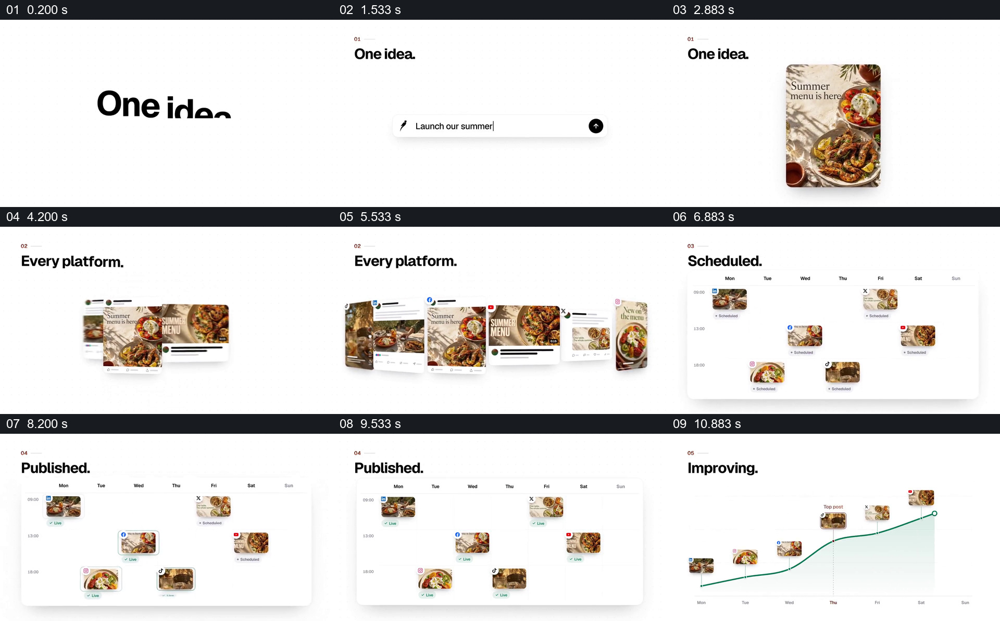

# 让一条食物创意依次成为多平台内容、排期与结果

- 作品：案例 024《食物图片与排期发布》（库内索引名称）。
- 原片范围：00:00.000–00:12.000，含起点、不含终点；[完整原片](../video.mp4)｜[本卡片段](c01.mp4)。
- 范围依据：从一个创意的输入开始，至多平台发布及结果曲线完成；之后进入品牌标识。
- 观察方式与未确认范围：查看整片 64 帧总览和本卡分镜。未独立完成连续原速观看与听审；抽帧之间的运动、停顿与声音配合待复核。画面中的界面、数字与说明是作品呈现，未经额外核实；设计价值为基于画面的分析。

## 原画面具体怎样设计

白底中央先出现“One idea”，输入框中写入发布夏季菜单的要求，随后一张竖向菜品海报占据中心，图上是餐盘与“Summer menu is here”。画面由文字要求变为可辨认的具体内容。

“Every platform”出现后，同一主题的食物图片被放进不同平台比例和界面中，横向并列为一排；这些页面分别有自己的头像、文字和边框，但仍能辨认共同的餐品。接着一周日历出现，不同平台缩略图分布在具体日期和时间，状态由 Scheduled 逐步变为 Live。

最后日历网格退让，餐品缩略图仍沿星期排列，绿色曲线从左向右上升，其中一项标成 Top post；这时重点从“安排在哪里”转为“内容的片中表现”。

## 为什么这样设计，好在哪里

同一批餐品图像贯穿海报、平台页面、日历和曲线，观众能追踪它们是同一项创意的不同状态。把不同平台先并列，再把它们分散放入星期格，改变的是组织方式；如果每次都换成无关图片，就难以理解从同一创意到排期的关系。

曲线和发布状态是原片演示，无法单独证明实际发布和效果。

## 完整照排指令

以[完整原片](../video.mp4)的 0–12 秒为准。画幅 1280×720，源帧率 60/1。以下拍点为抽帧定位，位置按画幅百分比取近似值。

### 用料

【内容指令】【菜单主视觉】【平台成品组】【排期卡组】【发布卡组】【结果曲线】关联同一次发布。主视觉有一眼可辨的食物和版面层次，平台版本保留同主题及主图素材；排期与发布逐项可配对。备【阶段词组】【品牌标识】【品牌副句】。真实日期、发帖状态及指标附可打开的记录、统计对象和日期。

### 按源时刻摆放

1. **0.000–约 2.000 秒。** 白底铺满，粗黑【阶段词组】首句先大字居中，随后提到左上。画中稍下显白长输入槽，左端小符号、右端黑圆确认，逐字填【内容指令】。
2. **约 2.000–4.000 秒。** 输入槽收掉，中心出竖幅【菜单主视觉】，暖食材与纸色构图和大片白底形成反差。主视觉停稳后，从其侧部依次添横竖不一的【平台成品组】，组成轻错落的横列，左上换第二条【阶段词组】。先前出现的主图保留在中轴附近，不被别处素材顶掉。平台按真实用途裁切，静态可淡显。
3. **约 4.000–8.000 秒。** 平台组让给白色宽日历，顶部细列按同一天数视图列对齐。左上先换为排期【阶段词组】；【排期卡组】由同一食物缩图与小字构成，放入相应日期槽。随后同一日历、相同卡位保留，标题换发布【阶段词组】，应用【发布卡组】的真实状态。勿重新随机分布卡片。缩图从入场贯穿排期至发布，可用定格。
4. **约 8.000–10.100 秒。** 白底上左上换【阶段词组】结果句。旧日历让位给由左低右高的细青【结果曲线】，下填很浅青色，数幅同源缩图放在各对应节点上方，数据只沿实测时点演进，不能以自动上升线证明推广成效。
5. **约 10.100–12.000 秒。** 图表整组退。中轴黑色鸟形符号及下方字标组成【品牌标识】，追加小【品牌副句】，至 12.000 秒切出。

### 局部采用

只有同一创意和平台成品可取约 0–4.500 秒。仅有排期、实际发布及对应数据，可取约 4.500–10.100 秒。缺可核查结果时切在曲线出现前。

### 验证状态

已对照逐秒原片画序并读回，核对输入与主视觉、平台横列、同一日历的两个状态及缩图进入结果图。精确切帧、日历小字、原速听看和换料试摆待核。
